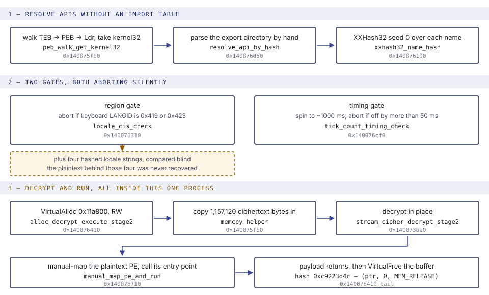
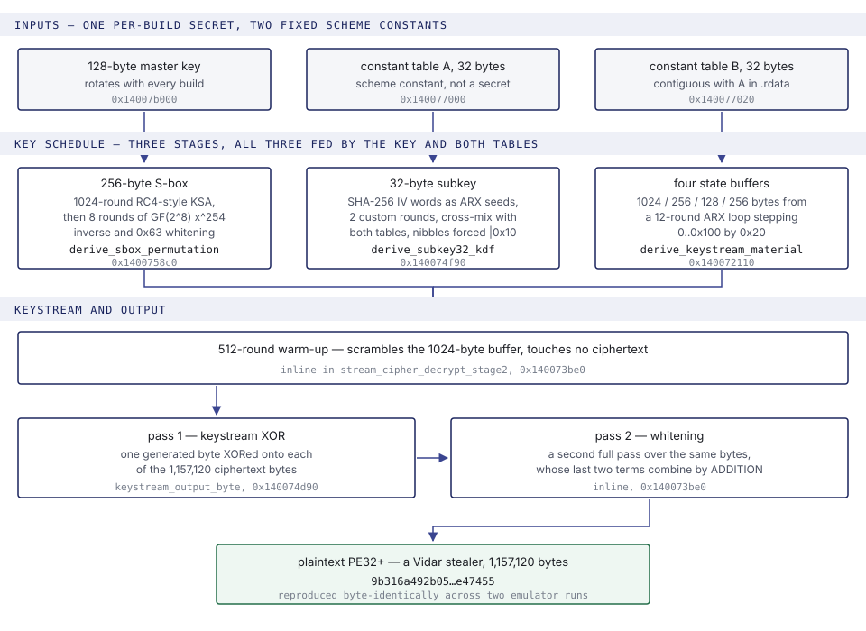
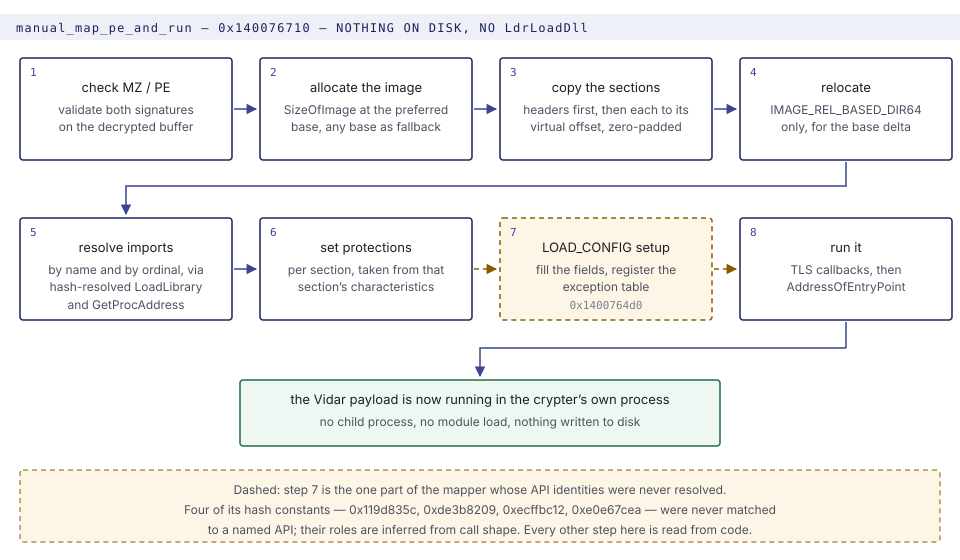

# ArxStream Crypter

> A single-purpose native x64 crypter delivered by GCleaner that does three things: check the keyboard layout, check the clock, then decrypt a megabyte of `.data` and run it inside itself. We ran the sample's own compiled cipher function under emulation, and it gave up a Vidar payload byte for byte.

> [!TIP]
> **Key highlights**
> - **One file, one job.** A pure crypter stub that decrypts an embedded PE and runs it in-process.
> - **Two silent gates.** Russian/Belarusian keyboard layout check and a tick-count timing gate — a failed run looks like a program that did nothing.
> - **Cipher proven by emulation.** The unpacker calls the sample's own machine code under Unicorn and reproduces the Vidar payload byte-identically.
> - **Bespoke ARX/S-box stream cipher.** Custom construction that reuses building blocks from RC4 (KSA loop), AES (S-box derivation math) and SHA-256 (IV constants as seeds).
> - **Inconsistent decoy layers.** The resources dress the file as a Visual Studio-style IDE client, but the icon is the Everex (EVX) crypto-payments logo — the mismatch suggests the builder pulls from separate pools rather than a coherent cover story.

## Observed sample

| Field | Value |
|---|---|
| SHA-256 | `5541bf99ebfee0f4c9ab33624b49e125348bf02280b9efbb8824919f53c8630c` |
| MD5 | `803fa2ddc9de8e377e526a06aca89551` |
| SHA-1 | `92ccc97910ee3975fed6762236e312e1982679b3` |
| imphash | `8c026516ad05f5d314ec1c5434fdfb68` |
| ssdeep | `24576:1FGTUpKp+DGzCxVcqAANnhVnIWxRuEiaemC1Dts0sJzvbRhm/om4GIk:dg+DGGncu1hVnIWxRtiaemCjxUDmJE` |
| File type | PE32+ x86-64, GUI subsystem, 8 sections, 1,896,960 bytes, no overlay |
| Compile timestamp | `0x6a847595` → 2026-08-18 UTC |
| Linker | MSVC, linker version 14.51 |
| Packer | It is itself the crypter — the `.data` section (entropy 7.9896) is the encrypted payload |
| Payload SHA-256 | `9b316a492b05f8ca06be4dd4158b33305f91b43a4879e61a25cd85f065e47455` (Vidar v3.0) |
| Signature | — |
| Delivery vehicle | Fetched as `MIX7.file` by the GCleaner update payload via `/service` |

## Starting point: chain position

We found ArxStream delivered by GCleaner's `mixthree` setup build. The GCleaner update DLL (`updateSW` export) fetches `/service` from the C2 and writes the response to `%APPDATA%` under a random filename. In this setup, one of those responses is `MIX7.file` — this crypter, carrying Vidar v3.0.

The name "ArxStream" is a project working name based on the cipher's add-rotate-xor construction and its stream-cipher architecture. We haven't found any public reporting on this family.

## What does this file do when it runs?

Run the EXE and it does its whole job in one process, start to finish, with no child process, no file written and no module loaded from disk. Three things happen in order: a locale check, a timing check, then decrypt-and-run. Both checks abort quietly with a non-zero exit and no side effects, so a failed run looks like a program that did nothing.

*Entry to payload, in one process. Resolve APIs without an import table, bail out on a CIS locale or a distorted clock, otherwise decrypt the embedded image into fresh memory, run it in this same process, then release the buffer. The dashed box is the one inferred element — the four hashed locale-string comparisons, whose plaintext was never recovered.*

### Step-by-step execution

| # | Step | Function / landmark | Address |
|---|---|---|---|
| 1 | Resolve APIs by export-name hash | `peb_walk_get_kernel32` → `resolve_api_by_hash` → `xxhash32_name_hash` | `0x140075fb0` / `0x140076050` / `0x140076100` |
| 2 | Read keyboard layout and locale; abort on `0x419` / `0x423` | `locale_cis_check` | `0x140076310` |
| 3 | Tick-count spin; abort on >50 ms deviation | `tick_count_timing_check` | `0x140076cf0` |
| 4 | `VirtualAlloc(0, 0x11a800, MEM_COMMIT|MEM_RESERVE, PAGE_READWRITE)` | `alloc_decrypt_execute_stage2` | `0x140076410` |
| 5 | Copy the ciphertext into the buffer | memcpy helper | `0x140075f60` |
| 6 | Decrypt in place | `stream_cipher_decrypt_stage2` | `0x140073be0` |
| 7 | Manual-map and call the entry point | `manual_map_pe_and_run` | `0x140076710` |
| 8 | `VirtualFree(buffer, 0, MEM_RELEASE)` | `alloc_decrypt_execute_stage2` tail call, hash `0xc9223d4c` | `0x140076410` |

## The two gates

### Region gate

It reads the current keyboard-layout language ID and aborts if it is Russian (`0x419`) or Belarusian (`0x423`). Those two numeric comparisons are read directly from code. It also pulls two locale fields and compares their hashes against four fixed values; those four are almost certainly the corresponding country and language abbreviations, but the plaintext was never recovered.

### Timing gate

It spins on a tick-count API until roughly one second has passed, then aborts if the measured elapsed time is more than 50 ms off 1000 ms. This kills naive single-stepping and coarse sandbox clock manipulation. It needs no `RDTSC` and no performance counter, so it is invisible to instrumentation that only watches those.

## Hiding its capability from static tools

### Decoy import table

The PE has a legitimate-looking import table, but it imports exactly three USER32 functions: `DialogBoxParamW`, `EndDialog` and `LoadMenuW`. These exist only to support the MENU resource compiled into the file. There is no `RT_DIALOG` resource, so `DialogBoxParamW` has no template — it is imported purely to pad the table. None of the three is ever called by the malicious code path. The entire real API surface is resolved at runtime.

### Runtime API resolution

Instead of importing functions normally, the stub walks TEB → PEB → Ldr → InMemoryOrderModuleList, takes the third entry (kernel32), parses that module's export directory by hand, and hashes each export name with XXHash32 (seed 0) until it finds a match against a stored constant. XXHash32 is an open-source non-cryptographic hash function. Because the hash is unmodified XXHash32 with a known seed, reversing every constant is straightforward: compute xxhash32(name, seed=0) over every export of a clean kernel32 and match against the constants in the indicator table below. All resolved API names are listed there.

### Two more builder-level disguises

***Export flooding.*** The export directory carries 1,055 machine-generated names — AccelerationScrolled, GradientApplyForce, HyperReshardExchange and so on — that all alias about 30 real code addresses. The file is an EXE (no IMAGE_FILE_DLL bit), so these exports serve no loader purpose; they exist to inflate the symbol table and waste analyst time. The vocabulary style is the signal, not any single name.

***Fabricated version info.*** The version resource carries a complete fake identity: `Lubowitz - Strosin` as company, `indexer` as product, `indexer_client.exe` as original filename, `Built with Multi-threading framework` as comment, `Copyright © 2019 Lubowitz - Strosin. All rights reserved.` as legal text. `Lubowitz - Strosin` is a pair of surnames that appears nowhere in legitimate software — the pattern matches the kind of random name generated by the [Faker](https://github.com/faker-js/faker) library (a developer tool for producing realistic-looking test data). Public search finds the exact pair only in unrelated Faker coincidences.

Both look like builder-template output. Whether either survives to the next build is unknown, which is why the generated detection rule requires only two of four version-info strings to match.

### The resource section is a fake desktop application

`.rsrc` holds 40 entries, all `en-US` (`0x409`, code page 1252): one `RT_MENU`, 28 `RT_STRING` blocks, one 9-size icon group, a version block and a manifest.

The **menu** carries Visual Studio-style top-level names — `File`, `Build`, `Debug`, `Design`, `Window`, `Layout`, `Database` — but items repeat (`&Compile`, `&Deploy`, `Step &Into`), command IDs run `10000`–`10038` mixed with random values, and several items carry invalid flags (`0x82`, `0x40`). The **434 strings** are about 70 distinct UI messages (`Connected to server.`, `Loaded records from database.`, `Licensed to: {0}`, `Serial: {0}`, `.NET Runtime: {0}`), repeated across blocks. The file is native code, so the `.NET` string describes nothing real. Together the resources suggest a generic licensed database or developer client. No real product is imitated. Nothing in the code uses any of it.

**The icon is the Everex (EVX) logo** — a blue disc with a white peak line (256×256 PNG, SHA-256 `65748a5555609e917df80477b6d5449b92fc3ed7a77be9ae2f08d844955cf609`). Everex is a crypto-based cross-border payments and micro-credit project. The icon does not fit the rest of the decoy, which describes a developer or database tool, so the icon and the menu/strings probably come from separate builder pools. Whether the builder picks crypto logos on purpose, at random, or from a fixed set is unknown from one sample.

Full resource contents are in `extracted_resources/`.

## The cipher

It is a four-stage key schedule feeding a byte-at-a-time keystream, built from borrowed pieces: an RC4-style key-scheduling loop, the AES S-box's GF(2⁸) `x^254` inverse used as a whitening primitive, and SHA-256's eight IV words used only as arbitrary mixing seeds. It might look like RC4, AES and ChaCha since it is the most common ARX (Add-Rotate-Xor) cipher. The SHA-256 constants are present, but no SHA-256 compression ever runs — they appear as scattered `MOV` immediates rather than the contiguous table a real implementation would use.

### Why we emulated instead of porting

`derive_keystream_material` at `0x140072110` decompiles with Ghidra's own `/* WARNING: Type propagation algorithm not settling */` header. `stream_cipher_decrypt_stage2` at `0x140073be0` renders one real pointer computation as `*(byte *)(local_60 + 0x2800ee00)`, a stack-slot-reuse artifact. A hand-port of that pseudocode would have produced plausible-looking wrong plaintext with no way to tell from the output.

So the unpacker loads the sample's own machine code into a Unicorn CPU emulator and calls `0x73be0` (RVA) directly, stubbing only the two allocator helpers, `0x140075e80` becomes a bump allocator and `0x140075f10` a no-op. Everything else in the cipher's call graph is pure arithmetic and runs unmodified.

### The master key

The 128-byte master key sits at `0x14007b000`. Its value is not published here: read the 128 bytes at that address in the sample.

> [!WARNING]
> **Per-build value**
>
> The key is assumed randomised per crypter output. An exact match elsewhere is strong evidence of the same builder run or a reused key. 

## Running the payload

The stub reimplements enough of the Windows loader to run an arbitrary PE inside itself, with no `LdrLoadDll` and nothing on disk. `manual_map_pe_and_run` at `0x140076710` validates DOS and NT headers, allocates the image, copies sections, applies 64-bit relocations, resolves the mapped image's imports, sets per-section protections, registers exception-table entries, runs TLS callbacks, then calls the entry point.

*The stub reimplements enough of the Windows loader to run an arbitrary PE inside itself. Steps 1–6 and 8 are all one function at `0x140076710`. Step 7 is a separate helper at `0x1400764d0`, drawn dashed because four of its hash constants were never matched to a named API — its role is inferred from call shape.*

> [!NOTE]
> **Unresolved cleanup branch**
>
> The LOAD_CONFIG helper has a cleanup branch, guarded by a flag pair, that was never seen taken and whose trigger condition is unresolved. Anyone re-running this analysis should expect to find it and should not assume it is dead code.

## MITRE ATT&CK

| Technique | ID | Observation |
|---|---|---|
| Obfuscated Files or Information: Software Packing | T1027.002 | The entire file is a crypter stub around an encrypted `.data` blob |
| Obfuscated Files or Information: Dynamic API Resolution | T1027.007 | PEB walk plus XXHash32 export-name hashing; a 3-entry decoy import table |
| Deobfuscate/Decode Files or Information | T1140 | The four-stage key schedule and two-pass keystream decrypt the embedded PE |
| Reflective Code Loading | T1620 | Full manual PE map into the stub's own process, then entry-point call |
| Virtualization/Sandbox Evasion: Time Based Evasion | T1497.003 | Tick-count spin aborting on >50 ms deviation from 1000 ms |
| Debugger Evasion | T1622 | The same timing gate defeats single-stepping |
| System Location Discovery: System Language Discovery | T1614.001 | Keyboard-layout LANGID and locale fields read, compared against `0x419` / `0x423` and four hashes |
| Masquerading | T1036 | Fabricated version resource and a 1,055-entry synthetic export table on a non-DLL |

No C2, persistence, collection or discovery-beyond-locale technique is mapped: none has any supporting API resolution in this binary.

## Reverse guide

### Where to start

Image base is `0x140000000`. Open `entry` at `0x140075d90`: it is eleven lines and gives you the whole program — gate, gate, payload. Then read `alloc_decrypt_execute_stage2` at `0x140076410`, which is the only caller of both the cipher and the mapper and hands you the key address, the ciphertext address and both sizes as literal arguments. Third, read `resolve_api_by_hash` at `0x140076050` — until you can map hash constants to API names, every other function looks like calls through unnamed pointers.

### Getting past the obfuscation

**API hashing.** The resolver walks `TEB → PEB → Ldr → InMemoryOrderModuleList` and takes the third entry (kernel32), parses that module's export directory by hand, and hashes each name with stock XXHash32, seed 0 — the primes `0x9E3779B1`, `0x85EBCA77`, `0xC2B2AE3D`, `0x27D4EB2F` and `0x165667B1` are all present verbatim. Compute `xxhash32(name, seed=0)` over every export of a clean kernel32 and match against the constants in the indicator table.

**Junk calls.** `junk_code_dispatcher` at `0x1400720c8` is called five times from `entry`, on every branch including the failure paths. It picks pseudo-random entries from a 2,950-entry function-pointer table at `0x1401965f0` and calls them 13 times; its return value is never read. Ignore it.

**Export flooding.** The 1,055 export names alias about 30 real code addresses clustered at `0x140075d00`–`0x140075e70`. Do not chase export names; they carry no information.

### Landmarks

| Address | Working name | Role |
|---|---|---|
| `0x140075d90` | `entry` | Eleven lines: locale gate → timing gate → decrypt-and-run |
| `0x1400720c8` | `junk_code_dispatcher` | 13 pseudo-random calls per invocation, return value discarded. **Off-path** |
| `0x140075fb0` | `peb_walk_get_kernel32` | PEB module-list walk to the kernel32 base |
| `0x140076050` | `resolve_api_by_hash` | Manual export-directory parse and hash match |
| `0x140076100` | `xxhash32_name_hash` | Stock XXHash32, seed 0; used for both API names and locale strings |
| `0x140075f40` | `strlen` | Helper for the resolver |
| `0x140076310` | `locale_cis_check` | Gate 1: aborts on `0x419` / `0x423`, or on four hashed locale strings |
| `0x140076cf0` | `tick_count_timing_check` | Gate 2: ~1000 ms spin, aborts on >50 ms deviation |
| `0x140076410` | **`alloc_decrypt_execute_stage2`** | Allocate → copy → decrypt → map and run → free. **The single best breakpoint in the binary** |
| `0x140075f60` | memcpy helper | Copies the ciphertext into the allocated buffer |
| `0x140073be0` | `stream_cipher_decrypt_stage2` | Cipher entry: three schedule stages, warm-up and both output passes. Executed under Unicorn |
| `0x1400758c0` | `derive_sbox_permutation` | 256-byte bijective S-box from the key plus both tables |
| `0x140074a20` | `gf256_inverse` | `x^254` in GF(2⁸), reduction polynomial `0x1b` |
| `0x140074f90` | `derive_subkey32_kdf` | 32-byte subkey via SHA-256-IV-seeded ARX |
| `0x140072110` | `derive_keystream_material` | The four remaining state buffers. **Decompiles unreliably** |
| `0x140073350` | `keystream_mix_round` | Per-byte state mixing |
| `0x1400739f0` | `keystream_byte_mix` | Inner byte mix |
| `0x140074d90` | `keystream_output_byte` | Produces the byte XORed onto the ciphertext |
| `0x140075e80` | alloc wrapper | PEB-resolved `VirtualAlloc`-class, for the six cipher state buffers. Stubbed in the unpacker |
| `0x140075f10` | free wrapper | Frees them via hash `0xc9223d4c` as `(ptr, 0, MEM_RELEASE)`. Stubbed in the unpacker |
| `0x140076710` | `manual_map_pe_and_run` | In-process PE mapper: sections, relocations, imports, protections, TLS, entry call |
| `0x1400764d0` | `loadconfig_cfg_setup` | LOAD_CONFIG fields and exception-table registration. **Four API hashes unidentified** |
| `0x14007b000` | `stage2_key` | The 128-byte master key |
| `0x14007b100` | `stage2_ciphertext` | The 1,157,120-byte encrypted PE |
| `0x140077000` | `cipher_table_a` | 32-byte constant table, mixed into every cipher stage |
| `0x140077020` | `cipher_table_b` | 32-byte constant table, contiguous with A |
| `0x1401965f0` | junk pointer table | 2,950 entries backing the decoy calls. **Off-path** |

### Left for the next pass

1. Brute-force the four region-gate locale hashes back to plaintext with an XXH32 dictionary over locale abbreviations.
2. Identify the four LOAD_CONFIG hash constants — `0x119d835c`, `0xde3b8209`, `0xecffbc12`, `0xe0e67cea` — against the same dictionary.
3. Settle the trigger condition of the LOAD_CONFIG cleanup branch.

## Indicators

> [!TIP]
> Read the Context column before the value: several of these identify a *scheme* or a *builder* rather than this file, and treating them as sample-identifying will produce false attribution.

| Value | Type | Context |
|---|---|---|
| `5541bf99ebfee0f4c9ab33624b49e125348bf02280b9efbb8824919f53c8630c` | SHA-256 | Sample hash |
| `92ccc97910ee3975fed6762236e312e1982679b3` | SHA-1 | Sample hash |
| `803fa2ddc9de8e377e526a06aca89551` | MD5 | Sample hash |
| `24576:1FGTUpKp+DGzCxVcqAANnhVnIWxRuEiaemC1Dts0sJzvbRhm/om4GIk:dg+DGGncu1hVnIWxRtiaemCjxUDmJE` | ssdeep | Near-identical rebuilds of the same stub |
| `T136954B8EB2726D84C39523B35365C629DCB8BDC2455F12FE08A93E3AC8739179977231` | TLSH | Same builder output with a different payload — more tolerant than ssdeep |
| `8c026516ad05f5d314ec1c5434fdfb68` | imphash | Clusters the 3-API USER32 decoy import set |
| `0x0022` — EXE with 1,055 exports and no `IMAGE_FILE_DLL` bit | COFF Characteristics | Export-flooding builder cluster — structural anomaly |
| `.pdata` 1,024 B / `.idata` 4,608 B / `.rsrc` 201,216 B / `.reloc` 6,144 B / `.idata`#2 512 B | Section layout fingerprint | Same builder template |
| 32 bytes at file offset `0x1d4028` — past EOF | Certificate Table directory | Builder artifact — structural anomaly |
| `0x14007b000` | Master key location (128 B), value not published | Per-build |
| `80 f3 8e 9e 24 0f a2 d6 d0 de ee 99 d1 48 61 45 e4 bc 92 ae 52 c5 55 aa f7 ff a4 c7 eb db 30 40` | Cipher table A @ `0x140077000` | Same cipher, any build |
| `b0 aa 96 cb c1 66 ef 82 45 9f ce c4 fe e6 9b 5f a0 d3 d1 49 e8 68 80 39 db a7 4f f8 34 cd ab d7` | Cipher table B @ `0x140077020` | Contiguous with A as a 64-byte blob — same cipher, any build |
| `0x14007b100`, `0x11a800` = 1,157,120 bytes | Ciphertext location and size | Same stub build |
| `0x6a09e667` `0xbb67ae85` `0x3c6ef372` `0xa54ff53a` `0x510e527f` `0x9b05688c` `0x1f83d9ab` `0x5be0cd19` | SHA-256 IV words (ARX seeds) | Same cipher family |
| `0x63` / `0x1b` | AES affine constant / GF polynomial | Same cipher family |
| `0x2559ef13` keyboard-layout · `0xabac9d89` locale-info · `0x80e273a9` tick-count · `0x5ebbb6ce` VirtualAlloc · `0xc9223d4c` VirtualFree · `0xfb3aaaef` LoadLibrary · `0x44553e20` GetProcAddress · `0x5a47632b` VirtualProtect · `0x7cee2c2d` RtlAddFunctionTable | API-hash constants (XXH32 seed 0) | Same resolver, any build — the most durable pivot |
| `0x119d835c` · `0xde3b8209` · `0xecffbc12` · `0xe0e67cea` | API-hash constants (unresolved) | Open work |
| `-0x73f607c4`, `-0x14273ce2` (LOCALE `0x5a`); `-0x76e355c9`, `-0x176c59f0` (LOCALE `0x59`) | Region-gate locale hashes | Plaintext unresolved — same gate implementation |
| `0x419` Russian · `0x423` Belarusian | Locale IDs (direct comparison) | CIS-avoidance tradecraft cluster |
| 1000 ms target, `0x32` (50 ms) tolerance | Timing-gate parameters | Same gate implementation |
| `Lubowitz - Strosin` | Decoy: Company | 2-of-4 string rule — same builder template or operator run |
| `indexer` / `indexer.exe` | Decoy: Product / Internal name | 2-of-4 string rule — same builder template |
| `indexer_client.exe` | Decoy: Original filename | 2-of-4 string rule — same builder template |
| `indexer Expert Controller` | Decoy: File description | 2-of-4 string rule — same builder template |
| `Built with Multi-threading framework` | Decoy: Comments | 2-of-4 string rule — same builder template |
| `Copyright © 2019 Lubowitz - Strosin. All rights reserved.` | Decoy: LegalCopyright | Same builder template |
| `indexer is a registered trademark of Lubowitz - Strosin in the US and other countries` | Decoy: LegalTrademarks | Same builder template |
| `3.2` | Decoy: FileVersion / ProductVersion | Supporting only — same builder template |
| `65748a5555609e917df80477b6d5449b92fc3ed7a77be9ae2f08d844955cf609` | Decoy: Icon SHA-256 | Everex (EVX) logo — pivot on this hash for other builds |
| `File`, `Build`, `Debug`, `Design`, `Window`, `Layout`, `Database`; IDs `10000`–`10038` | Decoy: RT_MENU | Generated Visual Studio-style menu with repeated items and invalid flags |
| 434 strings, ~70 distinct; `Connected to server.`, `Loaded records from database.`, `Licensed to: {0}` | Decoy: RT_STRING | Generic UI filler, repeated across 28 blocks |
| `en-US` (`0x409`), code page 1252, translation `040904B0` | Decoy: Resource language | Default value, no pivot |
| assembly `indexer`, version `3.2.0.0`, `asInvoker`, `longPathAware`, `activeCodePage=UTF-8` | Decoy: RT_MANIFEST | Matches the version-info identity |
| `DialogBoxParamW`, `EndDialog`, `LoadMenuW` | Decoy imports | Tied to unused MENU resource (no RT_DIALOG exists) — gates the imphash cluster |
| `0x6a847595` = 2026-08-18 UTC | PE `TimeDateStamp` | Same build window |
| `MIX7.file` | Upload filename | Names the collection batch, not the file |

