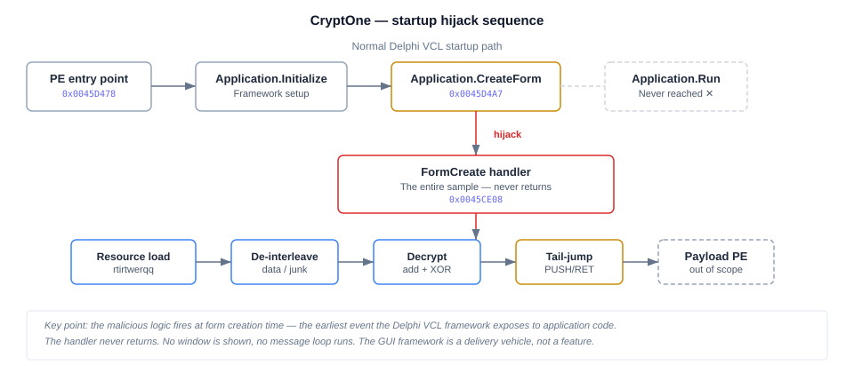
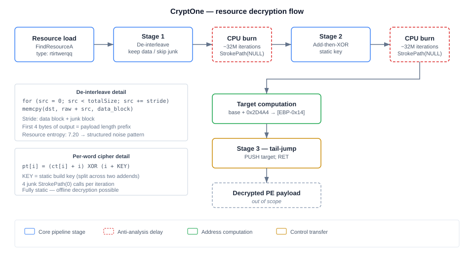

# CryptOne

> Delphi crypter layer — decrypts a PE payload from a custom-named resource and jumps straight into it in memory, before its own window is ever shown. Covers the wrapper, its decryption recipe, its anti-analysis padding, and what can be detected on it. The payload it carries is out of scope.

> [!TIP]
> **Key highlights**
> - **Decrypt-and-execute wrapper.** Single linear routine — reads a hidden resource, reverses a two-stage cipher, and tail-jumps into the result. No dispatch table, no command structure.
> - **Fully static decryption recipe.** Block de-interleave followed by per-word add-then-XOR with a fixed, build-specific key. No runtime-derived component — the resource can be decrypted offline from the file alone.
> - **Trust abuse.** Authenticode-signed with a QIHU 360 certificate (10 builds) or a Corel Corporation certificate (2 builds). Blank version-info fields betray that the signature is there to reduce suspicion, not to identify an author.

## Observed sample

| Field | Value |
|---|---|
| SHA256 | `84283e597223c0857b113cdb5b74f63eff49f9fa8addab0d759c491cd08b9aa5` |
| MD5 | `326967443551cd0c43e384fc79f38414` |
| SHA1 | `d4b220bfc004b00557f5bca7b311096d7e70d6b9` |
| imphash | `cbfcec59e4a5b111f28e442b8b24e1eb` |
| ssdeep | `12288:ujZlNYGf6jt1ho1t+GUyERe3eHFe0IebzYssoqYr4GlG:0lDoto31ue3MbIgs5Yr4d` |
| File type | PE32, Intel i386, Windows GUI subsystem, Delphi VCL forms application |
| Size / sections | 669,456 bytes, 8 sections (`CODE`/`DATA`/`BSS`/`.idata`/`.tls`/`.rdata`/`.reloc`/`.rsrc`); `.rsrc` entropy 7.07 |
| Encrypted resource | Type `rtirtwerqq`, name `tjertier6`, lang `1033`, 204,159 bytes, entropy 7.20, no recognisable magic |
| Compile timestamp | `1992-06-19` — the standard fixed Borland linker value, not a real date |
| Signature | `CN=QIHU 360 SOFTWARE CO. LIMITED`, serial `54:92:38:03:40:3d:c0:8b:e2:4f:0d:7c:8c:cc:55:93`, thumbprint `622271af668f99bd94ac12e5ebf86e48fd50aecb`. Leaf validity 2016-02-15 → 2019-05-02, kept technically current by a valid RFC3161 timestamp. All version-info fields blank |


## How does the crypter deliver its payload?




The malicious logic hijacks the Delphi framework's own startup sequence. The moment the main form is created  before the GUI is shown and before the message loop starts — the form's creation handler takes over and never returns. The application never reaches the point of showing a window.

The creation handler is the entire sample. It reads a hidden resource by a custom type/name pair, strips interleaved junk bytes, reverses a per-word cipher, burns CPU time twice to frustrate automated sandboxes, then hands control to the result by pushing the target address and executing `RET`.


*Reads as: the loader reads its own hidden resource, strips interleaved junk bytes, reverses a simple per-word cipher, burns CPU time twice to frustrate automated sandboxes, then hands control to the result by popping it straight into the instruction pointer — leaving no call instruction and no return address for anyone watching to break on.*

## What is the decryption recipe?


The whole scheme is two stages over one resource, with a fully static key. There is no runtime-derived component so the resource can be decrypted offline from the file alone.

| Parameter | Value (observed build) | Set at |
|---|---|---|
| Resource type | `rtirtwerqq` | pushed at `0x0045CE80`, string at `0x0045D04C` |
| Resource name | `tjertier6` | pushed at `0x0045CE85`, string at `0x0045D058` |
| Language | `1033` | — |
| Data block size | Build-specific | `0x0045CE42` → `[EBP-0x38]` |
| Junk block size | Build-specific | `0x0045CE49` → `[EBP-0x3C]` |
| Stride | Data block + junk block | derived, de-interleave loop |
| Add/XOR key | Build-specific | `0x0045CE3B` → `[EBP-0x34]`, combined at `0x0045CF9B` |
| Payload length | First 4 bytes of the de-interleaved buffer, little-endian | → `[EBP-0x30]` |
| Entry offset | Decrypted buffer base `+ 0x2D4A4` | computed `0x0045CFD4`–`0x0045CFE6` → `[EBP-0x14]` |

**Stage 1 — de-interleave.** Walk the raw resource in fixed strides, copying one data block and discarding the junk block that follows:

```text
for (src = 0; src < totalSize; src += stride) { memcpy(dst, raw + src, data_block); dst += data_block; }
```

**Stage 2 — per-word add-then-XOR.** Over the first *payload_length* bytes of the de-interleaved buffer, 32 bits at a time, with `i` stepping by 4:

```text
plaintext_dword[i] = (ciphertext_dword[i] + i) XOR (i + KEY)
```


**Stage 3 — transfer of control.** Six values are pushed as ad hoc arguments, then the computed target address is pushed last and a `RET` pops it into the instruction pointer. There is no `CALL` and no return address left on the stack for a breakpoint to catch.


> [!WARNING]
> **Build-specific parameters**
>
> Every value in the table above is build-specific. The resource names, the block sizes and the key rotate between builds.


## How do the analyzed builds differ?

The 12 CryptOne builds we analyzed fall into three parameter sets. The cipher and the Delphi/VCL wrapper are identical in all of them. Only the resource names, the block sizes and the key change, and the key changes from build to build even when the plaintext does not.


| | Set A | Set B | Set C |
|---|---|---|---|
| Resource type / name | `RTIRTWERQQ` / `TJERTIER6` | `RTIRTWERQQ` / `TJERTIER6` | `ERU3TRUYERTU35RT` / `ERTU45Y345Y3RFWDE` |
| File size | 669,456 | 1,135,376 / 1,148,688 / 1,151,760 | 3,649,824 / 3,795,744 |
| `CODE` section | 378,368 | 822,272 | 390,656 |
| Encrypted resource | 204,159 | 187,536 – 203,508 | 3,173,648 |
| Stage-2 size (decrypted) | 186,368 | 186,368 / 199,168 / 202,240 | 2,909,184 |
| Payload offset in stage-2 | `0x729` | `0x729` | `0x2998B9` |
| Known-plaintext match | case 19 (26 bytes) | case 19 (26 bytes) | case 20 (1,116 bytes) |
| Signing certificate (leaf) | `QIHU 360 SOFTWARE CO. LIMITED` | `QIHU 360 SOFTWARE CO. LIMITED` | `Corel Corporation` (Digital ID Class 3, issued by VeriSign Class 3 Code Signing 2004 CA) |
| Leaf validity | 2016-02-15 → 2019-05-02 | 2016-02-15 → 2019-05-02 | 2008-06-09 → 2009-06-30 |
| Timestamp CA validity | Symantec Time Stamping Services CA - G2: 2012-12-21 → 2020-12-30 | same as A | VeriSign Time Stamping Services CA: 2003-12-04 → 2013-12-03 |


## Anti-analysis

| Technique | Evidence | Assessment |
|---|---|---|
| CPU-burn busy-loop | Two `~0x1EF6154` (~32.3M) iteration loops of `PUSH 0; CALL StrokePath` bracketing the decrypt stage | **Confirmed.** `StrokePath(NULL)` fails immediately and does nothing — a real Win32 API used purely to consume wall-clock time, rather than `Sleep` or `GetTickCount`, which sandboxes commonly patch or fast-forward |
| Junk instructions and opaque predicates | A `MOV EDX,[ESI]; MOV [ESI],EDX` self-store no-op before the real add; four junk `StrokePath(0)` calls inside every decrypt iteration; the split key constant and its cancelling add/subtract pair | **Confirmed** — all hand-verified as net-zero operations whose only purpose is to obscure the data flow |
| Dynamic API resolution | `kernel32!VirtualAlloc` resolved through `GetModuleHandleA` + `GetProcAddress`; `WS2_32.DLL!WSAStartup` through `LoadLibraryA` + `GetProcAddress`. Neither is in the static import table | **Confirmed** — lightweight but real evasion of import-table scanning. Names are plain ASCII, not hashed |
| No-`CALL` control transfer | `PUSH target; RET` into the decrypted buffer | **Confirmed** — leaves no call instruction and no return address to break on |


## The certificates?

Every build is Authenticode-signed with a certificate that belongs to a named commercial vendor. Two leaf certificates appear, one per signing family: QIHU 360 on Sets A and B (10 builds), Corel Corporation on Set C (2 builds). All 10 QIHU builds carry the same signature data, and both Corel builds carry the same signature data. The signature was copied between builds.

| Field | QIHU 360 (Sets A, B) | Corel (Set C) |
|---|---|---|
| Subject | `CN=QIHU 360 SOFTWARE CO. LIMITED, OU=Client Security Group, O=QIHU 360 SOFTWARE CO. LIMITED, L=Hong Kong, S=Hong Kong, C=HK` | `CN=Corel Corporation, OU=Common Engineering Services, OU=Digital ID Class 3 - Microsoft Software Validation v2, O=Corel Corporation, L=Ottawa, S=Ontario, C=CA` |
| Serial | `54:92:38:03:40:3d:c0:8b:e2:4f:0d:7c:8c:cc:55:93` | `23:98:d3:bd:8a:6b:c1:44:a0:76:56:df:92:bb:d2:d0` |
| Thumbprint (SHA-1) | `622271af668f99bd94ac12e5ebf86e48fd50aecb` | `66d25922a4929f62838ea1fecbe7be9341a2ea60` |
| Leaf validity | 2016-02-15 → 2019-05-02 | 2008-06-09 → 2009-06-30 |
| Issuer | VeriSign Class 3 Code Signing 2010 CA | VeriSign Class 3 Code Signing 2004 CA |
| Timestamp CA | Symantec Time Stamping Services CA - G2 | VeriSign Time Stamping Services CA |
| Signing time in signature | `2016-04-26 13:06` UTC (inside leaf validity) | `2008-11-22 04:50` UTC, read from one unlabelled ASN.1 date (inside leaf validity) |


## MITRE ATT&CK

| Technique | ID | Supporting observation |
|---|---|---|
| Obfuscated Files or Information | T1027 | Custom-named encrypted resource hiding the embedded payload |
| Software Packing | T1027.002 | Block de-interleave plus cipher scheme protecting the embedded PE |
| Deobfuscate/Decode Files or Information | T1140 | Per-word add-then-XOR decrypt loop with a fixed key |
| Reflective Code Loading | T1620 | Tail-jump (`PUSH`/`RET`, no `CALL`) directly into the decrypted in-memory buffer |
| Virtualization/Sandbox Evasion: Time Based Evasion | T1497.003 | Two ~32M-iteration CPU-burn delay loops bracketing the decrypt stage |
| Subvert Trust Controls: Code Signing | T1553.002 | Authenticode signature from a QIHU 360 certificate (Sets A, B) or a Corel Corporation certificate (Set C) |


## Reverse guide

The program's real entry point is unremarkable framework boilerplate. The interesting code is reached one call later, at the point where the main form is instantiated — that single function is the entire sample. Addresses below are file VAs at image base `0x00400000`, as Ghidra maps them by default.

### Landmarks

| Address | Working name | Role |
|---|---|---|
| `0x0045D478` | `entry` | Standard Delphi/VCL startup stub. `Application.CreateForm(TForm1)` at `0x0045D4A7` fires the hijack |
| `0x0045CE08` | `FormCreate_cryptone_decrypt_and_transfer` | The sample's entire payload: resource load, de-interleave, decrypt, anti-sandbox delay, tail-jump |
| `0x0041973C` | `create_resource_stream` | Resource-stream constructor; receives the type/name string pair |
| `0x00419804` | `load_resource_data` | `FindResourceA` → `LoadResource` → `LockResource` → `SizeofResource` |
| `0x004190D8` | `copy_resource_to_buffer` | `TStream.Read` equivalent; copies the raw resource into the scratch buffer |
| `0x0041952C` | `store_resource_ptr_and_size` | `SetPointer(ptr, size)` on the memory stream |
| `0x0040697C` | `Move` equivalent | Borland RTL block copy, called by the de-interleave loop |
| `0x00406168` / `0x00406170` | import thunks | `GetModuleHandleA` / `GetProcAddress` |
| `0x00406478` | import thunk | `GDI32!StrokePath` — the busy-loop and junk-padding call target |
| `0x004539DC` | `indy_wsastartup_dynload` | Lazy `LoadLibraryA("WS2_32.DLL")` + `GetProcAddress("WSAStartup")`, cached. Never reached on the traced path before the tail-jump fires |
| `0x0044EAA4` / `0x0044EAE8` | Indy `TIdAntiFreeze` hook proc / installer | Stock `SetWindowsHookExA` UI-responsiveness plumbing — **not** a keylogger |

### Walking the decryption routine

Every stage of the recipe maps to a contiguous address range inside `0x0045CE08`. Set a breakpoint at the function head and step these in order:


| Recipe stage | Address range | What to look at |
|---|---|---|
| Constant setup | `0x0045CE3B` – `0x0045CE49` | Three `MOV dword ptr [EBP-x], imm32` writes: key component → `[EBP-0x34]`, data block size → `[EBP-0x38]`, junk block size → `[EBP-0x3C]`. This is where a new build's parameters are read off |
| Resource open | `0x0045CE80` – `0x0045CE97` | Two pushed string pointers (`0x0045D04C` = type, `0x0045D058` = name), the module-handle global at `0x00460668`, the stream class VMT at `0x004151C8`, then the call to `0x0041973C` |
| `VirtualAlloc` resolution | `0x0045CE9E` – `0x0045CEB3` | Pushes `0x0045D064` (`"VirtualAlloc"`) and `0x0045D074` (`"kernel32"`), resolves through the two thunks, caches the pointer in `[EBP-0x4C]` |
| Length prefix | before the copy loop | First 4 bytes of the raw resource are read into `[EBP-0x30]` and the raw pointer is advanced by 4. This is the decrypt loop's bound, not the resource size |
| Stage 1 — de-interleave | `0x0045CF58` – `0x0045CF7F` | Bound is `[EBP-0x40]` (total raw size). `EDI` advances by `[EBP-0x38]` then `[EBP-0x3C]` — the data/junk split is visible as two separate `ADD EDI` |
| Stage 2 — decrypt | `0x0045CF8D` – `0x0045CFD2` | `ADD [ESI],EBX` applies the running offset; the key is assembled into `EDI` across `0x0045CF98`–`0x0045CFA5`; `XOR [ESI],EDI` at `0x0045CFC7` applies it. The four `PUSH 0; CALL 0x00406478` between them at `0x0045CFAB`–`0x0045CFC2` are junk — step over them |
| Target computation | `0x0045CFD4` – `0x0045CFE6` | `0x2E4A0` + buffer base − `0x1000` + 4 → `[EBP-0x14]`. Dump the buffer here: this is the last point before control leaves the function |
| Anti-sandbox delay | `0x0045CFE9` – `0x0045CFF6` | `MOV EBX, 0x1EF6154` then a `DEC/JNZ` loop around the `StrokePath` thunk. Patch `EBX` to `1` to skip the stall |
| Stage 3 — tail-jump | `0x0045CFF8` – `0x0045D015` | Six pushes of stack locals, then the target pushed last and `RET` at `0x0045D015`. **Breakpoint here, not after** — there is no return address, so an ordinary step-out will not come back |

> [!NOTE]
> **Key recovery shortcut**
>
> Break at `0x0045CFC7` and read `EDI`. On the first iteration the running offset `i` is zero, so `EDI` holds the key itself. The two addends are visible as immediates at `0x0045CE3B` and inside the `ADD EDI, imm32` at `0x0045CF9B`; the `+`/`−` pair around them cancels and can be ignored.

To decrypt offline, the recipe needs exactly five values: resource type, resource name, data block size, junk block size, and the key. The resource type and name are listed above; the other three are build-specific and are read off the constant setup described in the walkthrough.


## Indicators

| Value | Type | Context |
|---|---|---|
| `84283e597223c0857b113cdb5b74f63eff49f9fa8addab0d759c491cd08b9aa5` | SHA-256 | File hash |
| `326967443551cd0c43e384fc79f38414` | MD5 | File hash |
| `d4b220bfc004b00557f5bca7b311096d7e70d6b9` | SHA-1 | File hash |
| `cbfcec59e4a5b111f28e442b8b24e1eb` | imphash | Import-table hash |
| `12288:ujZlNYGf6jt1ho1t+GUyERe3eHFe0IebzYssoqYr4GlG:0lDoto31ue3MbIgs5Yr4d` | ssdeep | Fuzzy hash |
| `rtirtwerqq` | PE resource type | Hidden-resource identifier, build-specific |
| `tjertier6` | PE resource name | Hidden-resource identifier, build-specific |
| `54:92:38:03:40:3d:c0:8b:e2:4f:0d:7c:8c:cc:55:93` | Certificate serial | Leaked QIHU 360 certificate |
| `622271af668f99bd94ac12e5ebf86e48fd50aecb` | Certificate thumbprint | Leaked QIHU 360 certificate |
| `23:98:d3:bd:8a:6b:c1:44:a0:76:56:df:92:bb:d2:d0` | Certificate serial | Corel Corporation certificate (Set C) |
| `66d25922a4929f62838ea1fecbe7be9341a2ea60` | Certificate thumbprint | Corel Corporation certificate (Set C) |
| `0x01EF6154` | Code constant | Anti-sandbox iteration count, build-specific |
| Decrypted buffer base `+ 0x2D4A4` | Code constant | Tail-jump target offset, build-specific |


**Decryption recipe (offline)**

```text
1. De-interleave: fixed stride (keep one data block, discard the junk block that follows)
2. Per-word cipher: plaintext_dword[i] = (ciphertext_dword[i] + i) XOR (i + KEY)
3. Payload starts at offset 4 (first 4 bytes = length prefix)
```

