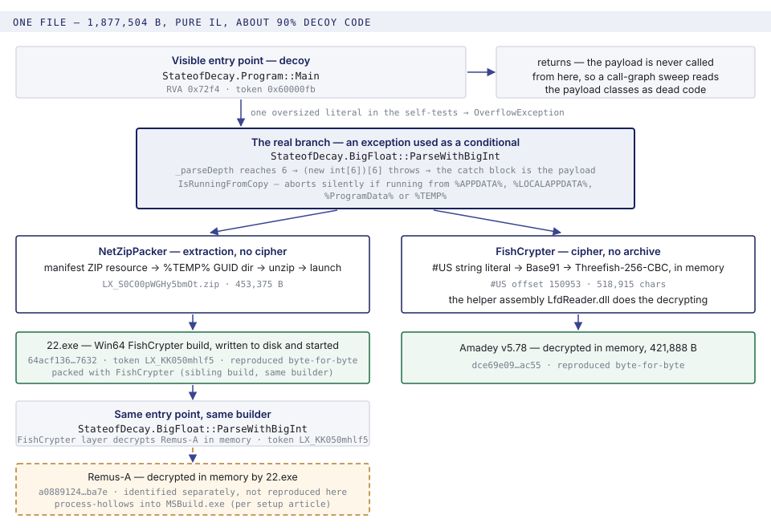
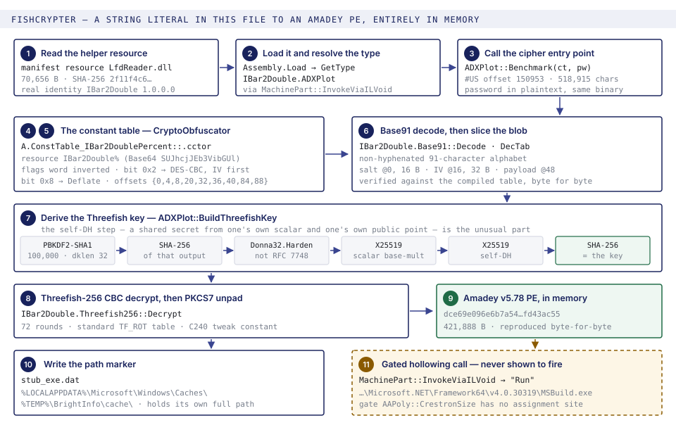
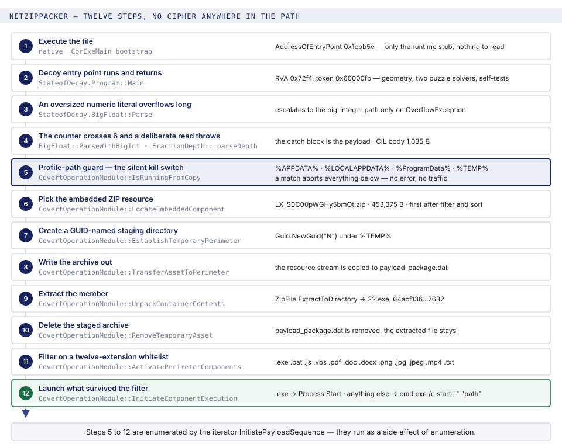

# FishCrypter and NetZipPacker

> A 1.87 MB .NET crypter delivered by GCleaner. Its hidden branch does two unrelated things: it decrypts an Amadey v5.78 backdoor in memory with a bespoke Curve25519-into-Threefish cipher, and it unzips a second FishCrypter build to disk, which in turn delivers Remus-A. We rebuilt both paths offline and reproduced both payload hashes.

> [!TIP]
> **Key highlights**
> - **A crypter with a dropper bolted on.** FishCrypter decrypts Amadey in memory. NetZipPacker only unzips a second FishCrypter build, which delivers Remus-A. Neither path feeds the other.
> - **Payload hidden behind an exception.** The entry point solves Advent-of-Code puzzles and returns. The payload sits in a `catch` block reached by a deliberate out-of-bounds read.
> - **Silent sandbox guard.** The drop aborts with no error and no traffic when the file runs from `%APPDATA%`, `%LOCALAPPDATA%`, `%ProgramData%` or `%TEMP%`.
> - **Cipher proven by reimplementation.** Our Python port reproduces the Amadey payload exactly. The password sits in plaintext in the outer EXE.


## Observed sample

| Field | Value |
|---|---|
| SHA-256 | `20082d2052d2d406bb4193990d933dc9b78bf2ccc3f2618144ada1fb7e0a995e` |
| MD5 | `8adc5c25b4fe2bfe0fd5d623ade01b76` |
| SHA-1 | `3088cd77ee02faf163202631d247c53fcb1185e5` |
| imphash | `f34d5f2d4577ed6d9ceec516c1f5a744` (only `mscoree.dll!_CorExeMain`, not useful) |
| ssdeep | `24576:XF8/OcAblxAAkKGR/xgDTC6JKKWOtY9/6dGXRsXsvVf:q/Oc6lxALKM/uS0/gJXqXs9` |
| File type | PE32 GUI, i386, pure IL (CLR flags `0x3`), 3 sections, 1,877,504 bytes, no overlay |
| Build time | Debug timestamp `0x6A89D833` → 2026-08-22 UTC. The PE `TimeDateStamp` (2048-11-24) is forced |
| Packer | It is itself the crypter. The ciphertext is a Base91 string, so `.text` entropy stays at 5.92 |
| Payload SHA-256 (FishCrypter) | `dce69e096e6b7a54db14431f5208870070503e1961e3f9912c6bbc42fd43ac55` (Amadey v5.78, in memory) |
| Dropped file SHA-256 (NetZipPacker) | `64acf136e30d15f4ff8fe0eee978d30c249d28ca7578cf60d138aa79cb4e7632` (`22.exe`, Win64 FishCrypter build) |
| Final payload of `22.exe` | `a0889124e151d08725f6ffe9b84b274cf157cc52ca305f9b66aa228ddb30ba7e` (Remus-A) |
| Signature | — |
| Delivery vehicle | Child of a GCleaner update payload (`updateSW` export) in our sample repository |


## What does the file do ? 



*The decoy entry point returns. One oversized literal in its self-tests overflows into the hidden branch, which holds both paths. NetZipPacker writes `22.exe`, a second FishCrypter build, to disk; FishCrypter decrypts Amadey in memory. Both output hashes were reproduced offline. The dashed box is the next hop, Remus-A, identified in a separate analysis and not reproduced here.*


## Module: StateofDecay

`StateofDecay` is the shared skeleton of this builder family. The namespace supplies the decoy entry point, the exception-based trigger that activates the hidden branch, and the sandbox guard that runs before either payload path.

### Decoy entry point

`Program::Main` (token `0x60000fb`, RVA `0x72f4`) draws polygons, solves two Advent-of-Code puzzles whose inputs are pasted in verbatim, tests a big-number parser, and returns.

The decoy is the result of ILRepack [[3]](#ref-3), an open-source .NET assembly merger, that merged a real NuGet library (`HomagConnect.ProductionManager.Contracts`) and two Advent-of-Code solvers into the outer EXE. The `ILRepack.List` resource, 210 bytes, names the two inputs verbatim and is left inside the final file.

Advent of Code [[4]](#ref-4) is an annual competitive programming event (Eric Wastl, first run 2015) that publishes one algorithmic puzzle per day each December. The two solver classes paste in fragments from two different years' puzzles: `px{a<2006:qkq,m>2090:A,rfg}` is the exact workflow-rule syntax from **2023 Day 19, "Aplenty"** [[6]](#ref-6), and `528,-643,409` is one of the example beacon coordinates from **2021 Day 19, "Beacon Scanner"** [[7]](#ref-7). Both literals are identical across the 2 builds we observed.

Names are plain English dressed as spy vocabulary (`EstablishTemporaryPerimeter`, `ActivatePerimeterComponents`): they read as a utility, not as obfuscation. One member per decoy class is repurposed for the payload: `AAPoly` is real geometry code, but its static `CrestronSize` gates the hollowing call; `BeaconResolver` is a real puzzle solver, but its `_r24` caches the injector type; `MachinePart` is a real puzzle record, but carries `InvokeViaILVoid`. 

### Exception trigger

The payload runs as a side effect of parsing a number too big for a 64-bit integer. `BigFloat::Parse` falls through to `ParseWithBigInt` on `OverflowException`. That method bumps a process-wide counter (`FractionDepth::_parseDepth`) on every call and reads `(new int[6])[counter]`. When the counter reaches 6 the read throws `IndexOutOfRangeException`, and the `catch` block is the whole payload. From there, two independent paths run.

> [!NOTE]
> **How the counter reaches 6 is unknown**
>
> `Main` supplies only one overflowing literal. The other increments must come from the two puzzle-solver classes, which were not decompiled in full.

The trigger is template-stable and confirmed in the sibling build (`22.exe`, token `LX_KK050mhlf5`). Every build that uses this builder carries the same `StateofDecay.BigFloat::ParseWithBigInt` entry point.

### Anti Copy / Sandbox guard

Before either path runs, `IsRunningFromCopy` compares the executable's own folder against the roaming profile (`CSIDL 0x1a`), the local profile (`CSIDL 0x1c`), `%ProgramData%` (`CSIDL 0x23`) and `%TEMP%`. A match stops execution with no crash, no error and no network traffic.

The method is named like an anti-re-execution check, but it works as sandbox evasion: automated detonation usually stages samples in exactly those four folders. Move the file somewhere else before running it.

**Obfuscation techniques.** A second Base91 string (`#US` offset `345`, 75,029 characters) sits next to the real ciphertext — an extractor that takes the first match gets the wrong string. `InvokeViaILVoid` builds a `DynamicMethod` named `DynamicCallerV` that calls `Assembly.Load(bytes).GetType(name).GetMethod("Run").Invoke(...)`: that chain exists only at JIT time, so a static search for `GetMethod("Run")` finds nothing.


## Module: FishCrypter

FishCrypter is the in-memory decryption module. It takes a ciphertext from the `#US` heap and a password from the same binary, loads a helper assembly, and returns a live Amadey v5.78 PE without touching disk.

### Cipher chain

The ciphertext is a 518,915-character Base91 string in the `#US` heap. The trigger passes it, with a password, to a helper assembly embedded as a resource (`LfdReader.dll`, real name `IBar2Double`). The helper decrypts it straight to an Amadey v5.78 PE in memory.

```text
Base91 decode
  → PBKDF2-HMAC-SHA1  (100,000 iterations, 32 bytes)
  → SHA-256
  → Donna32.Harden    (bespoke, not the RFC 7748 clamp)
  → X25519 scalar base-mult
  → X25519 self-DH    (own scalar against own public point)
  → SHA-256           = the Threefish-256 key
  → Threefish-256-CBC (72 rounds, C240 tweak)
  → PKCS7 unpad       = Amadey v5.78 PE
```

The self-DH step is the signature of this cipher. Deriving a shared secret from your own key pair adds no security, and it is unusual enough to cluster on. Every literal in the chain changes per build; the construction does not.



*Steps 1 to 9 were reimplemented in Python and reproduce the payload hash from this file. Step 10 writes the marker file. Step 11 is dashed: the hollowing call site exists but was never shown reached.*

> [!NOTE]
> **Named components: IBar2Double and ADXPlot**
>
> `IBar2Double` is the internal assembly name of the helper DLL (`LfdReader.dll`, 70,656 B). This sample was first tracked under that name before the outer EXE was attributed. The name deliberately mimics a financial or statistical library — `IBar` and `I2Double` are plausible data-type conversion functions in a charting SDK — so a quick strings dump or namespace scan reads as a third-party analytics library, not a cipher. No public reporting on this name was found.
>
> `ADXPlot` is the working name for this decryption layer, taken from the helper's own cipher entry point `IBar2Double.ADXPlot::Benchmark`. ADX is the Average Directional Index, a technical trading indicator, and ADXPlot would be a natural name for a function that charts it. That choice is deliberate: the method name, in context of an `IBar2Double` namespace, reads as a plotting routine in a financial library. No public reporting on `ADXPlot` as a malware name was found before this analysis.

### Step-by-step decryption

| # | Step | Function / landmark | Where |
|---|---|---|---|
| 1 | Read the helper resource | `ParseWithBigInt` catch block | resource `LfdReader.dll`, 70,656 B |
| 2 | Load it and resolve the type | `MachinePart::InvokeViaILVoid`, `Assembly.Load` | — |
| 3 | Call the cipher entry point | `IBar2Double.ADXPlot::Benchmark(ciphertext, password)` | `#US` offset `150953` |
| 4 | Decode the constant table | `ConstTable_IBar2DoublePercent::GetInt32Const` | resource `IBar2Double%` |
| 5 | Base91 decode and slice | `IBar2Double.Base91::Decode` | salt @0 (16 B), IV @16 (32 B), payload @48 |
| 6 | Derive the key | `ADXPlot::BuildThreefishKey`, `Donna32::Harden`, `X25519::SharedSecret` | in `LfdReader.dll` |
| 7 | Decrypt and unpad | `IBar2Double.Threefish256::Decrypt` | in `LfdReader.dll` |
| 8 | Return the PE | — | 421,888 B, `dce69e09…ac55` |

> [!WARNING]
> **Two decompiler readings were wrong**
>
> Both silently produce a key that does not decrypt.
> - `Donna32.Harden` is not an RFC 7748 clamp nor a curve25519-donna ladder. It is a fixed run of field add, subtract and negate operations ending in `pow(x, 2**252 - 3, p)` and a square-and-add. This attacker-written code is the strongest cryptographic fingerprint of the family.
> - In the protected-resource header, the two 8-byte fields are IV first, key second. The IL call order suggests the reverse.

> [!IMPORTANT]
> **The hollowing call is present but never shown to fire**
>
> A call site would pass the decrypted PE and the path `C:\Windows\Microsoft.NET\Framework64\v4.0.30319\MSBuild.exe` to a reflective `"Run"` method, the shape of process hollowing. The static field gating it (`AAPoly::CrestronSize`) has no assignment site in the 22 methods of its class. The other 130 classes were not swept. Do not report this as observed injection.

**A commercial protector** CryptoObfuscator [[5]](#ref-5) is a commercial .NET obfuscation product (LogicNP Software) applied to `LfdReader.dll` after the cipher was written — the helper PDB path ends in `…\CryptoObfuscator_Output\IBar2Double.pdb`, which is the tool's own output folder name.

Its job is to make the helper harder to read in a decompiler, not to pack or encrypt the payloads. It does this two ways: it moves every integer constant the cipher uses out of the code and into an encrypted resource blob, so the decompiled source shows an opaque lookup call instead of a plain number; and it wraps every trivial API call — array allocation, block copy, `.Length` — inside one of roughly 130 single-line stub classes with hash-generated names like `A.b3f2`, so the call graph is artificially inflated.

Neither technique changes what the cipher does. Strip CryptoObfuscator and both payloads decrypt identically.

> [!NOTE]
> **Why "IBar2Double" shows up in CryptoObfuscator's own class names**
>
> CryptoObfuscator's auto-generated helper classes follow a `<Purpose>_<ProtectedNamespace><Suffix>` naming template, so the namespace it is protecting (`IBar2Double`) gets pasted straight into the names it invents. Two of its generated classes were confirmed by decompile: `ConstTable_IBar2DoublePercent.GetInt32Const_DesDeflateObfuscatedConstant` (the integer-constant accessor, called ~130 times across `ADXPlot`/`Base91`/`Threefish256`) and `ResourceObfuscator_DesDeflateDecoder` (decodes the embedded `IBar2Double&&` resource that feeds it). `IBar2Double` itself is not a CryptoObfuscator function — it's the malware author's own namespace name, which CryptoObfuscator happened to fold into its own generated identifiers.

## Module: NetZipPacker

NetZipPacker is the .NET ZIP dropper. There is no cipher and no custom compression: it copies a ZIP resource to disk, calls `ZipFile.ExtractToDirectory`, and launches the result. It runs as the second path out of the StateofDecay trigger — after the sandbox guard passes — via the iterator `CovertOperationModule::InitiatePayloadSequence`.



*Steps 1 to 7 run as a side effect of enumerating the iterator `InitiatePayloadSequence`. Our extractor reproduced steps 1 and 4 and recovered `22.exe` at its recorded hash.*

### Step-by-step drop

| # | Step | Function / landmark |
|---|---|---|
| 1 | Pick the ZIP resource `LX_S0C00pWGHy5bmOt.zip` | `LocateEmbeddedComponent` |
| 2 | Create `%TEMP%\<GUID>\` | `EstablishTemporaryPerimeter` |
| 3 | Write it as `payload_package.dat` | `TransferAssetToPerimeter` |
| 4 | Extract `22.exe` | `UnpackContainerContents` |
| 5 | Delete the archive | `RemoveTemporaryAsset` |
| 6 | Keep files matching a twelve-extension whitelist | `ActivatePerimeterComponents` |
| 7 | `.exe` → `Process.Start`, anything else → `cmd.exe /c start "" "path"` | `InitiateComponentExecution` |

The whitelist mixes executable types (`.exe .bat .js .vbs`) with document and media types (`.pdf .doc .docx .png .jpg .jpeg .mp4 .txt`), so a strings dump reads like a generic file utility.

### Dropped payload: 22.exe

`22.exe` is a Win64 FishCrypter build from the same builder, under a different build token (`LX_KK050mhlf5`) and its own per-build password. It carries the identical `StateofDecay` class and method template — the same `BigFloat::ParseWithBigInt` trigger. It decrypts its own ciphertext with the same FishCrypter algorithm and delivers Remus-A (`a0889124…ba7e`) [[2]](#ref-2). 

## MITRE ATT&CK

| Technique | ID | Observation |
|---|---|---|
| Obfuscated Files or Information | T1027 | Merged decoy library, puzzle-code padding, themed method names, exception-as-branch trigger |
| Obfuscated Files or Information: Dynamic API Resolution | T1027.007 | `DynamicMethod` emitted at runtime for the reflective load-and-invoke |
| Deobfuscate/Decode Files or Information | T1140 | The FishCrypter chain, reproduced offline to the exact payload hash |
| Virtualization/Sandbox Evasion: System Checks | T1497.001 | `IsRunningFromCopy` aborts silently from a profile or temp folder |
| Ingress Tool Transfer | T1105 | Embedded ZIP member written to a `%TEMP%` subfolder and executed |
| Data Staged: Local Data Staging | T1074.001 | `payload_package.dat` staged then deleted; `stub_exe.dat` written to two folders |
| Process Injection | T1055 | *Unconfirmed.* Hollowing call site into `MSBuild.exe` with no reachable gate found |

No C2, credential access, discovery, collection or lateral movement is mapped: none of that logic exists in this file.


## Reverse guide

### Where to start

The native entry `0x1cbb5e` is only the runtime bootstrap. The managed entry token `0x60000fb` lands on `StateofDecay.Program::Main` (RVA `0x72f4`), which is all decoy.

First, `StateofDecay.BigFloat::ParseWithBigInt`: its `catch` block holds both payload paths. Second, the manifest resources: `LfdReader.dll`, `LX_S0C00pWGHy5bmOt.zip`, `ILRepack.List` and fourteen HOMAG localisation blobs. 

### Getting past the obfuscation

**The password is not encrypted.** It sits as plaintext UTF-16LE at file offset `0xc3c21`. The author protected the helper that decrypts and left the key in the caller.

Read it with `strings -el <sample>` and look at the string at that offset. Use `-el`: .NET stores strings as UTF-16, so a plain ASCII scan misses them.

**Pick the ciphertext.** Anchor the extractor on the `"Benchmark"` call, not on position or length. On this sample the real string happens to be the longer one, but the next build need not keep that order.

**The Offset spaces.** The table offsets `{0, 4, 8, 20, 32, 36, 40, 84, 88}` are positions inside the decoded `IBar2Double%` blob. The values they return (salt @0, IV @16, payload @48) describe the ciphertext layout.

**The constant table.** `IBar2Double%` is a resource name built from Base64 `SUJhcjJEb3VibGUl`. The decoder inverts a `ushort` flags word: bit `0x2` means an 8-byte IV and an 8-byte key followed by DES-CBC, bit `0x8` means inflate. If the key field is zero, it falls back to the assembly public-key token.

**Wrapper classes.** Resolve the ~130 hash-named wrappers by argument shape rather than renaming them one by one.

### Landmarks

| Address / location | Working name | Role |
|---|---|---|
| `0x1cbb5e` | native entry | `_CorExeMain` bootstrap, not the managed entry |
| RVA `0x72f4`, token `0x60000fb` | `Program::Main` | Decoy: geometry, two puzzle solvers, self-tests, `ret` |
| — | `BigFloat::Parse` | Escalates to the trigger only on `OverflowException` |
| CIL body 1,035 B | **`BigFloat::ParseWithBigInt`** | **The trigger.** Both payload paths in one `catch (IndexOutOfRangeException)` |
| static field | `FractionDepth::_parseDepth` | Call counter gating the trigger, reset to `-1` after firing |
| — | `CovertOperationModule::IsRunningFromCopy` | Folder guard: `CSIDL` `0x1a` / `0x1c` / `0x23` plus `GetTempPath` |
| — | `CovertOperationModule::InitiatePayloadSequence` | Iterator running drop steps 5 to 12 |
| `#US` offset `150953` | FishCrypter ciphertext | 518,915 Base91 characters |
| `#US` offset `345` | decoy ciphertext | 75,029 characters, not the payload |
| in `LfdReader.dll` | `IBar2Double.ADXPlot::Benchmark` | Cipher entry, `(ciphertext, password) → byte[]` |
| resource `IBar2Double%` | `ConstTable_IBar2DoublePercent` | Every integer constant of the cipher |
| in `LfdReader.dll` | `IBar2Double.Donna32::Harden` | Bespoke field transform. **Not** an RFC 7748 clamp |
| in `LfdReader.dll` | `IBar2Double.Threefish256::Decrypt` | 72-round Threefish-256, CBC, PKCS7 |
| — | `MachinePart::InvokeViaILVoid` | Emits `DynamicCallerV` for the reflective load-and-invoke |
| file offset ≈ `1840405` | marker block | Writes `stub_exe.dat` to two folders, errors swallowed |
| static fields | `AAPoly::CrestronSize`, `BeaconResolver::_r24` | Gate and type cache of the hollowing call. **No assignment found** |
| resource, 210 B | `ILRepack.List` | Names the two merged inputs |


### Left for the next pass

1. Sweep all 130 classes for writes to `AAPoly::CrestronSize` and `BeaconResolver::_r24`, and settle whether the hollowing call can fire.
2. Decompile the two puzzle-solver classes to explain how the counter reaches 6.
3. Recover the missing `CovertOperationModule` RVAs with a working decompiler.
4. Decode the decoy Base91 string at `#US` offset `345`.


## Build comparison

Both EXEs come from the same builder template. Everything per-build is procedurally generated — build tokens, passwords, timestamps and `VS_VERSION_INFO` filler — with no overlap between the two except the copyright line, the `_i.exe` suffix pattern, and the class/method skeleton itself.

`OriginalFilename` in both cases is the build's own internal token with an `_i` suffix — an ILRepack-merged/"intermediate". Neither version number (`2.8.45.0`, `3.9.2.16`) tracks anything real; they're as generated as the company and product strings sitting next to them.

| Field | Main sample (`LX_S0C00pWGHy5bmOt`) | Sibling `22.exe` (`LX_KK050mhlf5`) |
|---|---|---|
| SHA-256 | `20082d2052d2d406bb4193990d933dc9b78bf2ccc3f2618144ada1fb7e0a995e` | `64acf136e30d15f4ff8fe0eee978d30c249d28ca7578cf60d138aa79cb4e7632` |
| Build token | `LX_S0C00pWGHy5bmOt` | `LX_KK050mhlf5` |
| ZIP container resource | `LX_S0C00pWGHy5bmOt.zip`, 453,375 B (dropped by this build's NetZipPacker) | — (`22.exe` is the dropped payload, not a container) |
| Threefish password | Per-build, plaintext UTF-16LE | Per-build, plaintext UTF-16LE |
| Debug build timestamp | `0x6A89D833` = 2026-08-22 17:11:15 UTC | `0x6A89D7DF` = 2026-08-22 17:09:51 UTC (84 seconds earlier) |
| CompanyName | `Farmersville` | `touched in the wind` |
| ProductName | `quasi-gloriously` | `Granoff` |
| FileDescription | `poikilo-` | `potassium chloride` |
| FileVersion / ProductVersion / Assembly Version | `2.8.45.0` | `3.9.2.16` |
| InternalName / OriginalFilename | `LX_S0C00pWGHy5bmOt_i.exe` | `LX_KK050mhlf5_i.exe` |
| LegalCopyright | `Copyright (c) 2024` | `Copyright (c) 2024` |
| Comments | `in the know` | `borrowing days` |
| Final payload delivered | Amadey v5.78  (`dce69e096e6b7a54db14431f5208870070503e1961e3f9912c6bbc42fd43ac55`) | Remus-A  (`a0889124e151d08725f6ffe9b84b274cf157cc52ca305f9b66aa228ddb30ba7e`) |


## Indicators


| Value | Type | Context |
|---|---|---|
| `20082d2052d2d406bb4193990d933dc9b78bf2ccc3f2618144ada1fb7e0a995e` | SHA-256 | Sample hash |
| `3088cd77ee02faf163202631d247c53fcb1185e5` | SHA-1 | Sample hash |
| `8adc5c25b4fe2bfe0fd5d623ade01b76` | MD5 | Sample hash |
| `24576:XF8/OcAblxAAkKGR/xgDTC6JKKWOtY9/6dGXRsXsvVf:q/Oc6lxALKM/uS0/gJXqXs9` | ssdeep | Same builder, same padding mix |
| `T1F1952F603BEA61D9F077BE26C7EA7692D62FB3737A07965B1600030F0622542DF53939` | TLSH | Same builder output shape |
| `dce69e096e6b7a54db14431f5208870070503e1961e3f9912c6bbc42fd43ac55` | SHA-256 | Amadey v5.78 payload, 421,888 B, MD5 `ee2238ee066404885532728f74e8131e`. Exists only in memory |
| `64acf136e30d15f4ff8fe0eee978d30c249d28ca7578cf60d138aa79cb4e7632` | SHA-256 | `22.exe`, dropped by NetZipPacker. Win64 FishCrypter build, token `LX_KK050mhlf5` |
| `a0889124e151d08725f6ffe9b84b274cf157cc52ca305f9b66aa228ddb30ba7e` | SHA-256 | Remus-A, decrypted by `22.exe`. Not reproduced here |
| `2f11f4c64635677b83d5452a1ab385c0bd24feca1b678d1c2ed26297325dc849` | SHA-256 | Helper `LfdReader.dll` (`IBar2Double` 1.0.0.0). Identical in the sibling build |
| Threefish password (value withheld) | Threefish password | Per-build, plaintext UTF-16LE at `0xc3c21` in the main sample. The sibling has its own |
| `%LOCALAPPDATA%\Microsoft\Windows\Caches\stub_exe.dat` | Marker file | Template-stable. Direct endpoint sweep |
| `%TEMP%\BrightInfo\cache\stub_exe.dat` | Marker file | Template-stable. `BrightInfo` is invented, high precision |
| `%TEMP%\<GUID>\payload_package.dat` | Staging file | Template-stable, deleted after extraction |
| `22.exe` | Dropped filename | Weak alone |
| `cmd.exe /c start "" "<path>"` | Launch pattern | Generic. Combine with a .NET parent |
| `C:\Users\Administrator\AppData\Local\LX_CRYPTER\Temp\LX_S0C00pWGHy5bmOt\ILRepack-9872-514948\LX_S0C00pWGHy5bmOt.pdb` | PDB path | Best single string. `LX_CRYPTER` is identical in the sibling |
| `LX_S0C00pWGHy5bmOt` | Build token | Per-build. Assembly name, ZIP resource name, PDB folder |
| `LX_S0C00pWGHy5bmOt_i.exe` | InternalName / OriginalFilename | `_i` is an ILRepack intermediate-name trait |
| `LX_S0C00pWGHy5bmOt.zip`, 453,375 B | ZIP resource | Per-build |
| `IsRunningFromCopy` · `InitiatePayloadSequence` · `LocateEmbeddedComponent` · `EstablishTemporaryPerimeter` · `TransferAssetToPerimeter` · `UnpackContainerContents` · `RemoveTemporaryAsset` · `ActivatePerimeterComponents` · `InitiateComponentExecution` | Method names | Template-stable, confirmed in the sibling. Match 5 of 9 |
| `StateofDecay` · `BigFloat` · `FractionDepth` · `AAPoly` · `BeaconResolver` · `MachinePart` · `CovertOperationModule` | Namespace and classes | Template-stable family backbone |
| `DynamicCallerV` · `Benchmark` · `IBar2Double.ADXPlot` · `curve25519` · `X25519` · `Threefish` · `Base91` · `Donna32` | Cipher strings | Weak alone, strong in combination |
| `px{a<2006:qkq,m>2090:A,rfg}` · `--- region 0 ---` · `528,-643,409` | Decoy literals | AoC 2023 Day 19 "Aplenty" + AoC 2021 Day 19 "Beacon Scanner" (header word altered), identical across builds |
| `IBar2Double%` / `SUJhcjJEb3VibGUl` | Protected resource | Names the cipher's constant store |
| HMAC-SHA1, 100,000 iterations, 32 bytes | PBKDF2 parameters | Constant across this builder |
| `{0, 4, 8, 20, 32, 36, 40, 84, 88}` | Constant-table offsets | This helper build |
| `#US` @ `150953` (518,915 chars) / @ `345` (75,029 chars) | Ciphertext / decoy | Lengths cluster builds |
| `…\ENCDEC\DecryptLib\bin\Debug\CryptoObfuscator_Output\IBar2Double.pdb` | Helper PDB path | The cipher predates the protector |
| `ILRepack.List` naming `HomagConnect.ProductionManager.Contracts` | Merge artifact | Legitimate library. Retrohunt only |
| `C:\Windows\Microsoft.NET\Framework64\v4.0.30319\MSBuild.exe` | Referenced LOLBin | Inert call site, not behaviour |
| `Farmersville` · `quasi-gloriously` · `poikilo-` · `in the know` | Version-info filler (main sample) | Generated words. The generator is the pivot |
| `touched in the wind` · `Granoff` · `potassium chloride` · `borrowing days` | Version-info filler (sibling `22.exe`) | Same generator, different output. See Build comparison |
| `2.8.45.0` (main) / `3.9.2.16` (sibling) | Assembly / file version | Builder-generated, per build |
| `18256341-2b27-42d4-b6c6-f5f3f165f6d1` | MVID | This build only |
| `1b3fb55b-b612-914a-acb4-184978786f38` | PDB GUID | This build only |
| `0x6A89D833` (main) / `0x6A89D7DF` (sibling) = 2026-08-22 17:11:15 / 17:09:51 UTC | Debug timestamp | The sibling was built 84 seconds earlier |
| `0x9467eb20` = 2048-11-24 | PE `TimeDateStamp` | Forced value, a builder trait |
| `Big_Numbers3` · `VBox_Detection` · `XOR_hunt` · `Qemu_Detection` | Generic rules that fired | False leads. No VM check exists in the file |
| none | Network | No URL, IP, domain or network API. C2 lives in the Amadey payload |


## References

<a id="ref-1"></a>**[1]** [GCleaner Loader](../gcleaner/README.md)  
<a id="ref-2"></a>**[2]** [Gen Digital — Remus, a 64-bit variant of Lumma Stealer](https://www.gendigital.com/blog/insights/research/remus-64bit-variant-of-lumma-stealer)  
<a id="ref-3"></a>**[3]** [ILRepack — GitHub, gluck/il-repack](https://github.com/gluck/il-repack) — open-source .NET assembly merger; produces a `ILRepack.List` resource naming its inputs  
<a id="ref-4"></a>**[4]** [Advent of Code — adventofcode.com](https://adventofcode.com) — annual competitive programming event; "your puzzle input" is personalized per account, but the worked example printed in each puzzle's own statement is public and identical for every visitor  
<a id="ref-5"></a>**[5]** [CryptoObfuscator — LogicNP Software](https://www.ssware.com/cryptoobfuscator/obfuscator-net.htm) — commercial .NET obfuscator; routes integer constants through an encrypted resource blob and wraps API calls in hash-named proxy classes  
<a id="ref-6"></a>**[6]** [Advent of Code 2023, Day 19 — Aplenty](https://adventofcode.com/2023/day/19) — source of the `px{a<2006:qkq,m>2090:A,rfg}` workflow-rule literal  
<a id="ref-7"></a>**[7]** [Advent of Code 2021, Day 19 — Beacon Scanner](https://adventofcode.com/2021/day/19) — source of the `528,-643,409` example coordinate; the puzzle's own header reads `--- scanner 0 ---`, not the `--- region 0 ---` embedded in this sample
