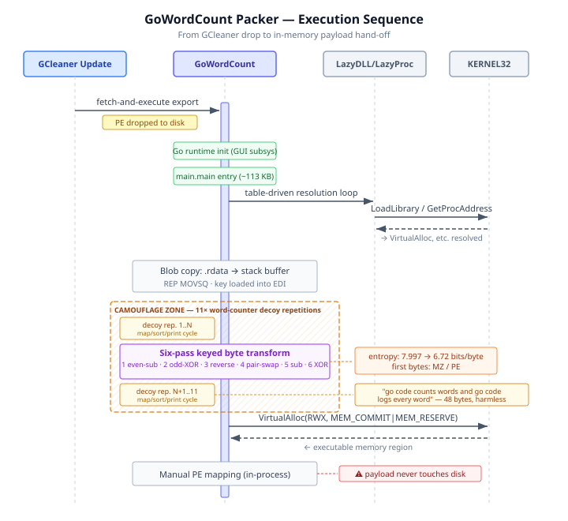

# GoWordCount Packer

> A garble-obfuscated Go packer dropped by GCleaner's update payload. It decodes an embedded x64 PE through a six-pass keyed byte transform hidden inside genuinely-executing decoy code.

> [!TIP]
> **Key highlights**
> - **Six-pass keyed byte transform, reproduced offline.** Even-index subtract, odd-index XOR, full reversal, adjacent-pair swap, keyed subtract, keyed XOR — all keyed by a 32-bit call-site literal. Run against the real bytes, the buffer's entropy drops from 7.997 to 6.72 bits/byte and the first bytes read `MZ` / `PE`.
> - **Computational camouflage** The obfuscator inlines a genuinely-executing word-counter program dozens of times inside every function — real `runtime.growslice`, `runtime.memequal`, `runtime.printlock` calls — burying the handful of real decode lines inside near-identical decoy blocks.
> - **Two builds analyzed** Both share the same six-pass algorithm and divisor constants (`53`/`97`), but carry different keys, blobs, call-site shapes and payloads. 


## Observed sample

| Field | First build | Second build |
|---|---|---|
| SHA256 | `21768f84350ec5f530bd1ebf6058c8840c55b0513eaca927b623500c81f834e2` | `b10c774e310afc6f2c71fc294b39b0402c8ace437e71bb1ece12473e0f22ebf3` |
| MD5 | `3b48178697b9231ef43c0f167c9202fc` | `1434f56494d7f652dc42b079d21c4a35` |
| SHA1 | `a4a8d13a68f2821d726bcd6b3f05d5d1fda5410b` | `ee2c2396cdd06d83a12b4511e968d2910b4da22d` |
| imphash | `4f2f006e2ecf7172ad368f8289dc96c1` | `c2d457ad8ac36fc9f18d45bffcd450c2` |
| ssdeep | `24576:3OoGbq+eUBQ9nRU4z0U8PerC15Ojmy+XyKf7Bi/WCR:pGb7oRUDUAYv4fsn` | `49152:xiTroEZyW7xK3fUOKt4i444dYq8hnSJ8WHNxhOrzBBxhx:pe44pgN8hx` |
| File type | PE32+, GUI subsystem, x86-64 | PE32+, GUI subsystem, x86-64 |
| Size / sections | 2,708,408 bytes; `.text`/`.rdata`/`.data`/`.pdata`/`.xdata`/`.idata`/`.reloc`/`.symtab`; max entropy 6.32 (`.rdata`); 8,120-byte overlay = Authenticode signature | 5,264,808 bytes; same 8-section name/order; max entropy 6.12 (`.text`); no section above 7.0 |
| Compile timestamp | `0` — zeroed in the PE header (checked 2026-11-12) | `0` — zeroed in the PE header |
| Go toolchain | Go 1.21.8 (`cmd/link`), garble-class source-level obfuscation | Go 1.22.1 — newer than the first build; no Go build ID string found |
| Imports | 45 functions, all `KERNEL32.DLL` — dynamic-resolution-only import table | 47 functions, all `KERNEL32.DLL` — same shape |
| Signature | Authenticode-signed — self-signed `CN=Cedar Stone Collective, O=Cedar Stone Collective, C=US`, serial `4ABCBA78CB40699FC829164169405DDC`, SHA-1 thumbprint `CA4983 75F10F 74E5F8 9417A7 A76FCD 565CEB F4C9`, signed 2026-08-23, DigiCert RFC 3161 countersignature one second later | Authenticode-signed — self-signed `CN=Delta Dynamics Group, O=Delta Dynamics Group, C=US`, serial `F2ED933CC6A11DBD87DC58EF12C79062`, SHA-1 thumbprint `A60475D2C515BDE13334329255DB22924D01912C`, 8,104-byte overlay, DigiCert RFC 3161 countersignature |
| Delivery vehicle | One of at least eight sibling drops from the GCleaner update payload's fetch-and-execute export | Same parent update payload, same drop wave |

> [!NOTE]
> **No entropy or import-table anomaly.** No section exceeds 6.33 bits/byte. Section names are the Go linker's own. No classic compressed-section packer and no VM-based protector — the protection is entirely at the source level.


## Execution sequence

The diagram below traces execution from arrival to payload hand-off.




## Anti-analysis

Three layers, applied uniformly across the entire `main` package, not just the entry function — plus a resolution mechanism that hides the API surface.

### Control-flow flattening

Every one of 36 sampled functions opens with a flattened dispatcher rather than linear code. `main.main` alone is ~113 KB of code with a 27,511-line basic-block listing (first build). The second build's `main.main` is ~870 KB (58 disjoint address ranges); the decompiler timed out on it.

### Identifier renaming

Short, randomized identifier names replace every function/type name in the `main` package — the classic fingerprint of the `garble` Go obfuscator [[3]](#ref-3) or an equivalent renaming pass, which by default also obfuscates string literals. An exhaustive string search found zero plaintext URLs, IPs, domains, registry paths, mutex names or User-Agent strings.

### Computational camouflage

Not a decoy prologue but large blocks of genuinely-executing code, repeated many times throughout each function's body, deliberately indistinguishable at a glance from real logic. The obfuscator inlines a complete, small Go program that:

1. Builds a fixed 48-byte sentence (`go code counts words and go code logs every word`) character by character
2. Computes a real word-frequency histogram via a `map[string]int`-shaped structure (real `runtime.growslice`, `runtime.memequal`, `runtime.panicIndex` calls)
3. Prints the running statistics through the `println` builtin's `runtime.printlock`/`printstring`/`printint`/`printsp`/`printnl`/`printunlock` primitives — harmless in a GUI-subsystem binary with no console attached
4. Discards the result and repeats

In the decoder this occupies well over half of the function's body, with eleven repetitions confirmed by disassembly. The real per-byte transform is nested many lexical scopes deep inside one of them. The same pattern recurs in the slice accessor.

> [!IMPORTANT]
> **The decompiled output is mostly decoy**
>
> A straight read of the decompiled output surfaces mostly decoy code. A transcription of one loop instance is a hypothesis until it is run against the real bytes. This sample's own analysis produced a "disproved" decoder that was correct but stopped two loops early.

**Second build.** Same garble-class stack, different decoy data. The decoy does not work on a sentence. It builds a `map[int]int`, fills it through `runtime.mapassign_fast64`, insertion-sorts a 10-element integer array and prints the numbers as decimal digits (the `/10` magic multiply `-0x3333333333333333` is the same in both builds). The first build's sentence is absent from the second build's bytes, and no replacement sentence exists. Only the shape is shared: build, sort, print, discard, repeated through the decoder body.

### Dynamic API resolution

Only `KERNEL32.DLL` is statically imported (45/47 functions, first/second build). The real API surface is resolved at runtime through a loop over a fixed-stride table of records — each holding a length field and name-string references — via `LoadLibrary`/`GetProcAddress` per entry. Normal for Go's lazy-binding idiom; here it is what kept `VirtualAlloc` out of the import table.

Second build: 22 call sites into the `LazyProc` mechanism all trace to one global pointer table (`.data` `0x8DF7E0`–`0x8DF840`) resolving 10 Go-runtime-internal primitives (`GetCurrentThread`, `NtQueryInformationThread`, `RtlAddFunctionTable`, `TlsAlloc`, `TlsSetValue`, `GetCurrentThreadId`, `VirtualAlloc`, `GetProcessHeap`, `HeapAlloc`, `GetTickCount64`, `GetCurrentProcessId`).

### What is absent

No classic compressed-section packer and no VM-based protector: no section exceeds 6.33 bits/byte, section names are the Go linker's own, and there is no protector-style import stub. Anti-VM / anti-sandbox checks are **unconfirmed either way** — generic heuristic rules fired, but no virtualization-vendor string exists anywhere in the binary.


## The decoding recipe

The decoder is called exactly once, at program start, on a buffer built at the call site rather than read straight from `.rdata`. The full transform was recovered in decompiled order and executed against the real bytes.

### Input buffer (first build)

At the call site in the program logic entry (`0x4dd4b3`–`0x4dd4f9`), a 64-bit literal is written to `[RSP+0x1a86]`; the raw blob at `.rdata` VA `0x592746` (`0x4ba40` bytes, file offset `0x191d46`) is then `REP MOVSQ`-copied (`0x9748` qwords) to `[RSP+0x1a88]`, overwriting bytes 2..7 of that literal. Only its first two bytes survive. The pointer handed to the decoder is `[RSP+0x1a86]` and the length is `0x4ba42` — the blob plus the two surviving prefix bytes. The 32-bit key is loaded into `EDI` at `0x4dd4ec` as a literal baked into the machine code — not derived from environment, network or runtime input, so the decode is fully offline-reproducible.

### Input buffer (second build)

The blob copy is a clean 1:1 copy with no leading prefix literal-write. At `0x4F586C`–`0x4F5880`, a `LEA`/`LEA`/`MOV ECX`/`REP MOVSQ` sequence copies `0x45A00` bytes (285,184) from `.rdata` VA `0x7BFBF0` (file offset `0x3beff0`) to a stack buffer at `[RSP+0x930]`, and the length passed to the decoder exactly equals the bytes copied. The key `0x7E404` is a hardcoded literal loaded into `EDI` at `0x4F5893`; the decoder is called once, at `0x4F589A`. The divisors `53`/`97` and the `mod 97` magic-multiply constant `-0x5717C0A8E83F5717` are byte-identical to the first build — only the key differs.

### The six-pass transform

| Pass | Transform (in place, mod 256, `i` = byte index) | Where in the routine |
|---|---|---|
| 1 | even `i`: `b[i] = b[i] - (key % 53) - 17*i` | one loop over the full buffer, nested inside one camouflage repetition |
| 2 | odd `i`: `b[i] = b[i] ^ (key % 97) ^ 31*i` | same loop as pass 1 |
| 3 | full-buffer reversal | swap-from-both-ends loop |
| 4 | adjacent-pair swap: `b[j] <-> b[j+1]` for even `j` | — |
| 5 | `b[i] = b[i] - ((key >> 8) & 0xFF) - 3*i` | a further whole-buffer loop buried inside a later decoy repetition |
| 6 | `b[i] = b[i] ^ (key & 0xFF) ^ 5*i` | same, further down |

> [!WARNING]
> **Four passes are not enough**
>
> A transcription of passes 1–4 alone, run against the real bytes, leaves the buffer at ciphertext entropy (7.900 bits/byte against 7.997 raw) — and six alternative orderings of those four passes all land in the same 7.8–8.0 range. That is exactly what the incomplete decoder produced on the second pass, and why it was reported as disproved. Passes 5 and 6 sit further down the same function, each inside a later camouflage repetition.

### Output (first build)

`([]byte pointer, length)`, the length unchanged from the input (`0x4ba42` = 309,826 bytes). The result is a PE32+ x64, GUI subsystem, entry `0x20a0`, image base `0x140000000`, sections `.text/.rdata/.data/.reloc` (raw end `0x36e00`) plus an 85,058-byte overlay of random alphanumerics. Imports: `KERNEL32` (`GetComputerName[Ex]A`, `GlobalLock`…), `USER32` (`GetDC`, `GetWindowDC`, `OpenDesktopW`, `EnumDisplaySettingsW`, `GetKeyboardLayout`…), `GDI32` (`BitBlt`, `GetDIBits`, `CreateCompatibleBitmap`…), `ole32`/`OLEAUT32` (`CoCreateInstance`, `CoSetProxyBlanket`, `SysAllocString`, `Variant*` — WMI), `ADVAPI32` (`GetUserNameA`, `LookupPrivilegeValueW`). Payload SHA-256: `f68b10e6f53c620cec7cde3d7f31d9be1d0c35d1bf9ccf304908540460642ad7`.

### Output (second build)

PE32+ GUI image, 285,184 bytes, entry point `0x20a0`, image base `0x140000000`, sections `.text`/`.rdata`/`.data`/`.reloc`, imports from `KERNEL32.dll` (6), `ole32.dll` (5), `USER32.dll` (13), `ADVAPI32.dll` (2), `GDI32.dll` (9), `OLEAUT32.dll` (4), 51,712-byte overlay. Payload SHA-256: `650c2b3efe7e25ff0abf1f02512d59103547bbfb165d4bb5394c68cdd2fb0450`. Not analysed as its own sample.

### What the packer does with it

**First build:** the fixed `(0x40, 0x3000)` argument pair at both invocation call sites is `PAGE_EXECUTE_READWRITE`, `MEM_COMMIT|MEM_RESERVE` — the dynamically resolved API is `VirtualAlloc` and the decoded PE is manually mapped in-process. The shared structure at `[RSP+0x4d4f8]` is most likely the parsed PE headers / mapping context.

**Second build:** untraced. The decoded `[]byte` is kept inside `main.main`'s own stack frame and never published to a package-level global. `main.main` could not be decompiled, so everything downstream of `0x4F58AF` is untraced.


## Build comparison

The two builds run the same six-pass decoder and differ in key, blob, size, toolchain, signer and payload. Values marked † were filled by a reverse pass on 2026-11-12 (PE parsing, `openssl`, byte search and disassembly of both samples, plus a re-run of `unpackers/gowordcount_unpacker`).

| | First build (1B) | Second build (2B) | Same? |
|---|---|---|---|
| Loader SHA-256 | `21768f84…81f834e2` | `b10c774e…0f22ebf3` | no |
| Size | 2,708,408 bytes | 5,264,808 bytes | no (+2.5 MB) |
| Go toolchain | 1.21.8 | 1.22.1 | no |
| Section layout | `.text` `.rdata` `.data` `.pdata` `.xdata` `.idata` `.reloc` `.symtab` | same names, same order | yes |
| PE `TimeDateStamp` † | `0` | `0` | yes (zeroed by the Go linker) |
| Imports | 45 × `KERNEL32.DLL` | 47 × `KERNEL32.DLL` | shape only |
| Authenticode signer † | `Cedar Stone Collective`, serial `4ABCBA78CB40699FC829164169405DDC`, valid 2026-08-16 to 2027-08-23 | `Delta Dynamics Group`, serial `F2ED933CC6A11DBD87DC58EF12C79062`, valid 2026-09-09 to 2027-09-16 | no — new self-signed cert per build |
| Signature layout † | 8,120-byte overlay, DigiCert RFC 3161 countersignature | 8,104-byte overlay, DigiCert RFC 3161 countersignature | same pattern |
| `main.main` | `0x4dcac0`, ~113 KB, decompiles | `0x4f4460`, ~870 KB, decompiler times out | no |
| Decoder function | `0x508dc0` | `0x6c5a40` | no |
| Decoy data | word-frequency count over the sentence `go code counts words and go code logs every word` (`.rdata:0x5667bd`) | integer count: `map[int]int` and a 10-element array sorted by insertion, no sentence | no — same shape (build, sort, print), different data |
| Blob in `.rdata` | VA `0x592746`, `0x4ba40` bytes | VA `0x7bfbf0`, `0x45a00` bytes | no |
| Blob copy shape | 8-byte literal written first, `REP MOVSQ` overwrites bytes 2..7, 2-byte prefix survives, buffer `0x4ba42` | clean 1:1 copy, no prefix, buffer `0x45a00` | no |
| 32-bit key | `0xCFA97` (`EDI` at `0x4dd4ec`) | `0x7E404` (`EDI` at `0x4F5893`) | no |
| Six-pass algorithm | as in the recipe | as in the recipe | yes |
| Divisors / magic constant | `53`, `97`, `-0x5717C0A8E83F5717` | same | yes — family pivot |
| `VirtualAlloc` argument pair † | `(0x40, 0x3000)` at `0x4de8d1` and `0x4f9d9e`, call to `0x533360` | `(0x40, 0x3000)` at `0x4f73da` and `0x511e59`, call to `0x5268a0` | same pattern, two sites in each |
| Payload SHA-256 | `f68b10e6…0642ad7` | `650c2b3e…fb0450` | no |
| Payload size | 309,826 bytes | 285,184 bytes | no |
| Payload PE † | PE32+ GUI, entry `0x20a0`, base `0x140000000`, linker 14.0, `SizeOfImage` `0x3b000` | same, `SizeOfImage` `0x3d000` | mostly |
| Payload `.text` / `.rdata` raw † | `0x2e400` / `0x2200` (entropy 7.35) | `0x30200` / `0x2400` (entropy 7.22) | no |
| Payload imports † | 39 functions, imphash `27742d1bf6f86ef7fe780b678bfbbfbf` | 39 functions, same imphash, same function list | yes |
| Payload overlay † | 85,058 bytes of random letters and digits | 51,712 bytes of random letters and digits | no |
| Payload compile timestamp † | `2026-08-23 14:08:27` UTC | `2026-09-16 22:57:46` UTC | no |
| Payload analysed | yes — Remus-A | no | — |

> [!NOTE]
> **The two payloads are two compiles of one program.** They have the same import list and imphash, the same section names and the same layout. Only the sizes, the timestamps and the overlay differ. The second payload's family is not confirmed because it was never analysed on its own. Same imphash and imports support a Remus-A link and do not prove it.

> [!NOTE]
> **The signer follows the build date.** Each loader carries a certificate created days before its payload was compiled (1B: cert 2026-08-16, payload 2026-08-23. 2B: cert 2026-09-09, payload 2026-09-16). The attacker made a new certificate for each build.


**Still open on the second build:** the code between the decoder return at `0x4F589A` and the two allocation sites, the exact order of the mapping steps, and the identity of the payload.

## MITRE ATT&CK

| Technique | ID | Supporting observation | Confidence |
|---|---|---|---|
| Obfuscated Files or Information | T1027 | Control-flow flattening, identifier renaming, extensive genuinely-executing decoy code, and an encrypted master data blob | High — read from decompiled code |
| Software Packing | T1027.002 | The loader's next stage exists only as a keyed, encoded blob inside `.rdata`, decoded at runtime | High |
| Deobfuscate/Decode Files or Information | T1140 | Six-pass keyed byte transform decodes the embedded PE payload at program start — reproduced offline on both builds | High — reproduced |
| Reflective Code Loading | T1620 | Decoded PE is manually mapped in-process via dynamically resolved `VirtualAlloc` (`PAGE_EXECUTE_READWRITE`, `MEM_COMMIT|MEM_RESERVE`); never written to disk | Medium — first build from argument constants; Low on the second (call site located, flag literals not traced) |
| Shared Modules | T1129 | DLL/export pairs resolved dynamically via table-driven `LoadLibrary`/`GetProcAddress` rather than static linkage | High — wired |
| Native API | T1106 | Program logic invokes the resolved function(s) directly, bypassing the binary's own linked network stack | High — wired |
| Virtualization/Sandbox Evasion | T1497 | Generic heuristic hits only; no triggering artifact string was found | Low — unconfirmed |


## Reverse guide

### The first build

Addresses are file VAs at image base `0x00400000`. The entry point is the standard Go runtime startup stub — not itself informative.

#### Landmarks

| Address | Working name | Role | Confirmed by |
|---|---|---|---|
| `0x45fd20` | `_rt0_amd64_windows` | Standard Go runtime entry | disassembly |
| `0x4dcac0` | `main.main` | Program logic entry (~113 KB, control-flow-flattened); calls every routine below | disassembly / call-graph trace |
| `0x4dd4b3`–`0x4dd4f9` | Blob copy and decoder call site | Writes 64-bit literal to `[RSP+0x1a86]`, `REP MOVSQ`-copies the blob to `[RSP+0x1a88]`, loads key into `EDI` at `0x4dd4ec`, then calls the decoder | byte-by-byte disassembly |
| `.rdata:0x592746` | Master blob | `0x4ba40` raw bytes (file offset `0x191d46`); the encrypted payload | entropy sweep; section table |
| `0x508dc0` | Payload decoder | Consumes the buffer and returns the embedded PE. Six passes — see recipe. `makeslice`/`memmove` setup around `0x50920c`; epilogue `0x50f965`–`0x50f980` returns pointer + length | executed against real bytes → valid PE |
| `0x5092ce`, `0x509c32`, `0x50a5ce`, `0x50af8e`, `0x50b94e`, `0x50c2e5`, `0x50cd7b`, `0x50d74e`, `0x50e145`, `0x50eb02`, `0x50f4ae` | Camouflage repetitions | Eleven byte-identical dead-end branches of the decoy word-counter; real transform loops sit between them | disassembly, Ghidra's "Removing unreachable block" warnings |
| `.rdata:0x5667bd` | Decoy sentence | `go code counts words and go code logs every word` (48 bytes) | string table |
| `0x500240` | Startup string/API-resolution routine | Loops over a table of 20-byte records, resolving DLL/export pairs via `LoadLibrary`/`GetProcAddress` per entry. Called from `main.main` at `0x4e56f7` | disassembly trace |
| `0x50fa60` | Blob slice/substring accessor | Not an independent decoder — slices an already-decoded region and returns a Go `string` view. Single confirmed `RET` at `0x514850` | decompilation (~2,600 lines) |
| `0x533360` | WinAPI invocation wrapper | `syscall.(*LazyProc).Call` wrapper; two call sites in `main.main`, both reading `[RSP+0x4d4f8]` and passing `EDI=0x40`, `ECX=0x3000` — `VirtualAlloc` | disassembly, cross-referenced call sites |

#### Walking the first build

| Stage | Address range | What to look at |
|---|---|---|
| Entry | `0x45fd20` | Standard Go runtime — step through to `main.main` |
| Blob copy | `0x4dd4b3`–`0x4dd4f9` | The 64-bit literal write, `REP MOVSQ` copy, key load into `EDI`. **Read the key here** |
| Decoder call | `0x4dd4ec`–`0x4dd4f9` | Key in `EDI`, `CALL` to `0x508dc0`. **Break on the return**: decoded `[]byte` at pointer `[RSP+0x4d988]`, length `[RSP+0x11a0]`, cap `[RSP+0x11a8]` |
| Payload decoder | `0x508dc0` | Six passes in decompiled order. Passes 5 and 6 at decompiler lines ~1965 and ~2139 of 3,748. Search for arithmetic blocks that do NOT reference the decoy sentence or `runtime.print*` |
| API resolution | `0x500240` | Loop over 20-byte records (`record = table_base + 20*RSI`). Length field at `record+0xC`. Shared structure at `[RSP+0x4d4f8]` read at `0x4e56f7` |
| VirtualAlloc call | `0x533360` | Two call sites, both `EDI=0x40`, `ECX=0x3000`. The decoded PE is manually mapped here |

### The second build

Addresses at image base `0x00400000`. `main.main` could not be decompiled (~870 KB, 58 disjoint address ranges, decompiler timed out). The blob copy and decoder call were located by disassembly, anchored on a byte search for the `REP MOVSQ` idiom (`F3 48 A5`, 4 hits total, one inside `main.main`).

#### Landmarks

| Address | Working name | Role | Confirmed by |
|---|---|---|---|
| `0x464120` | `_rt0_amd64_windows` | Stock Go runtime entry | entry-point listing |
| `0x4F4460` | `main.main` | Program logic entry; ~870 KB, never decompiled | function analysis (58 disjoint ranges) |
| `0x4F586C`–`0x4F5880` | Blob copy site | `LEA`/`LEA`/`MOV ECX`/`REP MOVSQ` copying `0x45A00` bytes from `.rdata` VA `0x7BFBF0` to `[RSP+0x930]`; clean 1:1 copy, no prefix | disassembly; re-derived from raw bytes |
| `0x4F589A` | Decoder call site | `CALL` to `0x6C5A40`; `EDI` set to `0x7E404` at `0x4F5893`. Decoded `[]byte`: pointer `[RSP+0x4bce8]`, cap `[RSP+0x47df0]`, len `[RSP+0x47de8]` | disassembly; cross-references |
| `0x6C5A40` | Payload decoder | Full six-pass algorithm; 17 disjoint ranges spanning `0x6C5A40`–`0x6D0CE4`. Passes 1/2 at line ~1942, 3 at ~2185, 4 at ~2425, 5 at ~2668, 6 at ~2907 of the 6,775-line output | decompilation; **execution-proven** |
| `0x6C6120` / `0x6C648D` | `runtime.makeslice` / `runtime.memmove` | Allocate working buffer; copy raw blob before the six passes | cross-references |
| `0x5268A0` (call `0x526FC0`) | `VirtualAlloc` caller | Resolves and calls `VirtualAlloc` via `LazyProc` table; 4-field arg struct; flag literals not traced | disassembly; `LazyProc` pointer names `VirtualAlloc` |
| `0x8DF7E0`–`0x8DF840` | Global `LazyProc` pointer table (`.data`) | 10 entries; 22 `LazyProc.Call` sites all trace here | data reads |
| `0x48D560`–`0x4EFFA0` | Struct type methods (15+ methods) | Unique to this build; candidate for the ~2.5 MB extra size vs first build | named, never traced |


## Indicators

> [!TIP]
> Build key: **1B** = first build · **2B** = second build · **B** = both.

### Hashes

| Value | Type | Build | Context |
|---|---|---|---|
| `21768f84350ec5f530bd1ebf6058c8840c55b0513eaca927b623500c81f834e2` | SHA-256 | 1B | First build |
| `b10c774e310afc6f2c71fc294b39b0402c8ace437e71bb1ece12473e0f22ebf3` | SHA-256 | 2B | Second build |
| `3b48178697b9231ef43c0f167c9202fc` | MD5 | 1B | First build |
| `1434f56494d7f652dc42b079d21c4a35` | MD5 | 2B | Second build |
| `a4a8d13a68f2821d726bcd6b3f05d5d1fda5410b` | SHA-1 | 1B | First build |
| `ee2c2396cdd06d83a12b4511e968d2910b4da22d` | SHA-1 | 2B | Second build |
| `4f2f006e2ecf7172ad368f8289dc96c1` | imphash | 1B | First build |
| `c2d457ad8ac36fc9f18d45bffcd450c2` | imphash | 2B | Second build |
| `f68b10e6f53c620cec7cde3d7f31d9be1d0c35d1bf9ccf304908540460642ad7` | SHA-256 | 1B | Decoded payload (first build) |
| `650c2b3efe7e25ff0abf1f02512d59103547bbfb165d4bb5394c68cdd2fb0450` | SHA-256 | 2B | Decoded payload (second build) |
| `a8dc66320efc4e1d5279408415c055a9` | MD5 | 2B | Decoded payload (second build) |

### Host and code identity

| Value | Type | Build | Context |
|---|---|---|---|
| Go 1.21.8 | Toolchain | 1B | Compiler version |
| Go 1.22.1 | Toolchain | 2B | Compiler version (newer) |
| `go code counts words and go code logs every word` | Decoy sentence | 1B | `.rdata:0x5667bd` — absent from the second build |
| `CN=Cedar Stone Collective` | Authenticode signer | 1B | Self-signed; serial `4ABCBA78CB40699FC829164169405DDC` |
| `CN=Delta Dynamics Group` | Authenticode signer | 2B | Self-signed; serial `F2ED933CC6A11DBD87DC58EF12C79062`; SHA-1 `A60475D2C515BDE13334329255DB22924D01912C` |
| `27742d1bf6f86ef7fe780b678bfbbfbf` | imphash | B | Decoded payloads of both builds |
| `syscall.NewLazyDLL` / `syscall.(*LazyDLL).NewProc` | Go stdlib strings | B | Dynamic-resolution mechanism fingerprint |
| `.text`/`.rdata`/`.data`/`.pdata`/`.xdata`/`.idata`/`.reloc`/`.symtab` | Section layout | B | Byte-identical name/order in both builds |

### Crypto and configuration

| Value | Type | Build | Context |
|---|---|---|---|
| `.rdata` VA `0x592746`, file offset `0x191d46`, `0x4ba40` bytes | Blob location | 1B | Encrypted payload |
| `.rdata` VA `0x7BFBF0`, file offset `0x3beff0`, `0x45A00` bytes (285,184) | Blob location | 2B | Encrypted payload |
| `0xCFA97` (decimal 850583) | Decode key | 1B | `MOV EDI` at `0x4dd4ec` |
| `0x7E404` (decimal 517124) | Decode key | 2B | `MOV EDI` at `0x4F5893` |
| `key%53`, `key%97`, `(key>>8)&0xFF`, `key&0xFF` | Derived sub-constants | B | Six-pass formula per-index terms |
| Divisors `53`/`97`, magic-multiply `-0x5717C0A8E83F5717` | Algorithm constants | B | Byte-identical between builds — the strongest family-level pivot |

### Payload decryption recipe

Deterministic, fully solved for both builds.

```text
key       = 32-bit literal from EDI at the decoder call site
pass 1    even i: b[i] = b[i] - (key % 53) - (17*i & 0xFF)
pass 2    odd  i: b[i] = b[i] ^ (key % 97) ^ (31*i & 0xFF)
pass 3    full-buffer reversal
pass 4    adjacent-pair swap: b[j] <-> b[j+1] for even j
pass 5    b[i] = b[i] - ((key >> 8) & 0xFF) - (3*i & 0xFF)
pass 6    b[i] = b[i] ^ (key & 0xFF) ^ (5*i & 0xFF)
```

## References

<a id="ref-1"></a>**[1]** [GCleaner Loader — KB sheet](../gcleaner/README.md) <br />
<a id="ref-2"></a>**[2]** [Malpedia — win.gcleaner](https://malpedia.caad.fkie.fraunhofer.de/details/win.gcleaner)  <br />
<a id="ref-3"></a>**[3]** [garble — Obfuscate Go builds](https://github.com/burrowers/garble)  <br />
<a id="ref-4"></a>**[4]** [Gen Digital — Remus: 64-bit variant of Lumma Stealer](https://www.gendigital.com/blog/insights/research/remus-64bit-variant-of-lumma-stealer)  <br />
<a id="ref-5"></a>**[5]** [Unit 42 — Remus Info Stealer Uses Blockchain-Anchored C2](https://github.com/PaloAltoNetworks/Unit42-timely-threat-intel/blob/main/2026-07-30-Remus-Info-Stealer-Uses-Blockchain-Anchored-C2.txt)  <br />
<a id="ref-6"></a>**[6]** [Flashpoint — Remus Stealer: A New (Not So New) Infostealer](https://flashpoint.io/blog/remus-stealer-a-new-not-so-new-infostealer/) <br />
